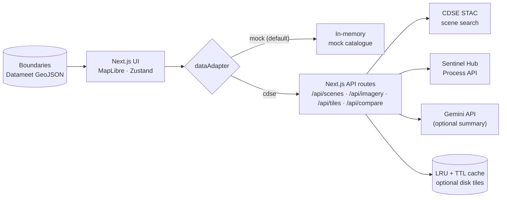

<div align="center">

# 🛰️ Rajasthan Imagery Explorer

**Browse, compare and download Sentinel-2 satellite imagery over Rajasthan, clipped to District → Tehsil → ILR areas, and see what changed between two dates.**

[](https://github.com/Vatxsal/rajasthan_satellite_imagery_analysis/actions/workflows/ci.yml)
[](LICENSE)
[](.nvmrc)
[](https://dataspace.copernicus.eu/)


[Quick Start](#-quick-start) · [Features](#-features) · [Connect Copernicus](#-connecting-copernicus-cdse) · [Change Detection](#-change-detection) · [Deploy](#-deploying-to-vercel) · [Roadmap](#-roadmap) · [Troubleshooting](#-troubleshooting)

</div>

<!-- Add screenshots to docs/screenshots and uncomment:
<p align="center"></p>
-->

---

> **Zero-setup demo.** The app runs out of the box on an in-memory mock catalogue, with no backend, database or API keys required. Set `NEXT_PUBLIC_DATA_SOURCE=cdse` to switch to live Copernicus Data Space Ecosystem (Sentinel-2) imagery. See [Connecting Copernicus](#-connecting-copernicus-cdse).

## 📑 Table of Contents

- [Features](#-features)
- [Quick Start](#-quick-start)
- [Architecture](#-architecture)
- [Connecting Copernicus (CDSE)](#-connecting-copernicus-cdse)
- [Quota & Cost](#-quota--cost)
- [Change Detection](#-change-detection)
- [AI Summary (Gemini)](#-ai-summary-gemini)
- [Email Report](#-email-report)
- [Known Limitations](#-known-limitations)
- [Deploying to Vercel](#-deploying-to-vercel)
- [Security & Guard Rails](#-security--guard-rails)
- [Testing & CI](#-testing--ci)
- [Manual QA Checklist](#-manual-qa-checklist)
- [Project Layout](#-project-layout)
- [Design Tokens](#-design-tokens)
- [Boundary Data](#-boundary-data-datameet-census-2011)
- [Plugging in a Real DataAdapter](#-plugging-in-a-real-dataadapter)
- [Roadmap](#-roadmap)
- [Troubleshooting](#-troubleshooting)
- [Attribution & Data Sources](#-attribution--data-sources)
- [Author](#-author)
- [License](#-license)

---

## ✨ Features

| | Feature | What you get |
| :-: | --- | --- |
| 🧭 | **Shell** | 48px top bar (wordmark, selection breadcrumb, theme toggle, user menu), 56px icon rail, 320px contextual panel (collapse with `[`), full-screen map and a docked scene strip. Below 1024px the panel becomes a bottom sheet and the scene strip a swipeable list. |
| 🔎 | **Filters** | District → Tehsil → ILR cascade, date presets (30d / 90d / 6m / Calendar), cloud-cover slider with numeric input, composite control (true colour / false colour / NDVI), sticky Search / Reset bar. The calendar highlights dates that have scenes for the selected area. |
| 🖼️ | **Scenes** | One card per acquisition day (daily mosaic) with thumbnail, UTC date and time, cloud % bar, **coverage % of the selected area** and the scene id. Sort by lowest cloud or newest, with skeleton and empty states. |
| ⬇️ | **Downloads** | Per-scene menu: true-colour **PNG** preview; **GeoTIFF (visual, 8-bit RGB)** that opens correctly in any viewer; **GeoTIFF (analysis)**, FLOAT32 reflectance and index bands with nodata for data processing; deep links into Copernicus Browser / Data Space with per-tile `.SAFE` product ids, date and zoom pre-filled; copy single or all product ids. All clipped to the selection (≤ 2500 px per side, with a reduced-resolution option for big areas). |
| 🗺️ | **Map** | OpenFreeMap *positron* vector basemap (English labels) with an Esri World Imagery switcher, zoom / home / locate / fullscreen controls with screenshot menu, debounced Nominatim address search, selection highlight with `fitBounds`, live cursor coordinates, legend and composite legend (NDVI colour bar). |
| 🛰️ | **Imagery overlay** | XYZ tile mode renders **native-resolution 512px tiles** per pan/zoom, clipped to the selected area, with empty-tile short-circuits (outside area, out-of-band zoom, too many tiles) so quota is only spent on visible, in-area tiles. Opacity slider, true / false colour / NDVI, flicker-free swaps. |
| 🔍 | **Change detection** | Compare two dates (A/B) for the current area: **Swipe** side-by-side, classified **Changes** map (water / vegetation / bare-built gain & loss) with legend and per-class toggles, **Stats** by class and by tehsil, **Hotspots** (top-10 patches as numbered map markers with popups), **Summary** (optional AI briefing in English or हिन्दी), and PNG / GeoTIFF / CSV / GeoJSON exports. See [Change Detection](#-change-detection). |
| 🧱 | **Layers** | Eye toggles for district / tehsil / ILR boundaries and the imagery overlay (inline opacity slider), plus a scene footprint toggle. Rajasthan state outline with casing lines keeps borders visible on any basemap, in light and dark themes. |
| 🌗 | **Themes** | Light / dark, persisted. Boundary, selection and change-layer colours mirror the theme on the map and are restored after every theme switch. |
| 📏 | **Measure / Saved queries** | UI shells wired to the store state. |

---

## 🚀 Quick Start

> **Requires Node ≥ 20.9** (Node 20 LTS recommended; `.nvmrc` pins 20).

```bash
git clone https://github.com/Vatxsal/rajasthan_satellite_imagery_analysis.git
cd rajasthan_satellite_imagery_analysis
npm install
cp .env.example .env.local     # PowerShell: Copy-Item .env.example .env.local
npm run dev                    # http://localhost:3000
```

With the defaults the app runs on the mock catalogue. For live imagery follow [Connecting Copernicus](#-connecting-copernicus-cdse).

<details>
<summary><b>All available scripts</b></summary>

```bash
npm run build      # production build (type-checks + lints)
npm run start      # serve the production build
npm run lint       # eslint (next/core-web-vitals)
npm run typecheck  # tsc --noEmit
npm test           # unit tests (node --test): downloads, Copernicus links, change detection
npm run verify     # typecheck + lint + test + build (what CI runs, minus smoke)
npm run generate:mock-data   # regenerate data/mock/*.geojson
npx tsx scripts/fetch-datameet.ts   # (re)download Rajasthan boundaries (network, not part of the build)
node scripts/smoke.browser.cjs      # headless-browser end-to-end smoke (needs Chrome)
```

</details>

---

## 🏗️ Architecture



Components and the store only talk to a single `dataAdapter` singleton, so the data source can be swapped without touching the UI. All Copernicus and Gemini calls happen **server-side**; the browser never sees a credential.

---

## 🌍 Connecting Copernicus (CDSE)

Live Sentinel-2 imagery is already wired in. Nothing in the UI changes; you only flip one env var.

### 1. Get credentials (step by step)

1. Create a free account at [dataspace.copernicus.eu](https://dataspace.copernicus.eu/) and verify your email.
2. Open the **Sentinel Hub dashboard**: <https://shapps.dataspace.copernicus.eu/dashboard/>.
3. Go to **Account Settings → OAuth clients → Create**, name it (for example `rajasthan-imagery`) and create it.
4. **Copy the client ID and the secret immediately.** The secret is shown only once.
5. Put them in `.env.local` (see `.env.example`):

```bash
CDSE_CLIENT_ID=your-client-id
CDSE_CLIENT_SECRET=your-client-secret
NEXT_PUBLIC_DATA_SOURCE=cdse
```

6. Restart `npm run dev` and open `http://localhost:3000/api/health/cdse`. You want `{ "status": "ok", ... }`.

> ⚠️ Create the OAuth client in the **Sentinel Hub dashboard**, not on the identity "Applications" page. Credentials from the wrong place fail with `invalid_client` or `401`.
>
> 🔐 `CDSE_CLIENT_ID` / `CDSE_CLIENT_SECRET` are **server-only** (no `NEXT_PUBLIC_` prefix), so they never reach the browser bundle. This is verified by a bundle scan in the release checklist.

### 2. What happens under the hood

| Concern | Route | Behaviour |
| --- | --- | --- |
| **Adapter** | `lib/data/index.ts` | Picks `cdseAdapter` when `NEXT_PUBLIC_DATA_SOURCE=cdse`. Boundaries still come from local GeoJSON; only scene search and imagery go to CDSE. |
| **Scene search** | `POST /api/scenes` | STAC catalogue query (Sentinel-2 L2A), cloud-cover filtered, grouped into one scene per day with per-tile product ids and coverage math. Areas larger than `MAX_AOI_KM2` are rejected before any quota is spent. |
| **Imagery** | `GET\|POST /api/imagery` | Sentinel Hub Process API render clipped to the polygon (RGBA PNG transparent outside the AOI, or GeoTIFF). Evalscripts live in `lib/cdse/evalscripts.ts`. Responses are cached in-memory (LRU + TTL) keyed by geometry + date + composite + size + format, and served as a **chunked stream** (see [Deploying to Vercel](#-deploying-to-vercel)). |
| **Tiles** | `GET /api/tiles/{z}/{x}/{y}` | One Process render per XYZ tile at native resolution (zoom band 7 to 14), disk-cached when `TILE_CACHE_DIR` is set (off on Vercel). |
| **Compare** | `/api/compare/*` | Change analysis, overlay and AI summary. See [Change Detection](#-change-detection). |
| **Errors** | all routes | Every route returns `{ code, message }`. Auth, config and quota failures map to friendly codes (see [Troubleshooting](#-troubleshooting)). |
| **Health** | `GET /api/health/cdse` | Reports whether a token can be obtained. Never returns secrets. |
| **AI health** | `GET /api/health/gemini` | Runs a tiny probe against the configured Gemini model. Returns `{ ok, model, status }` on success or the mapped AI error code otherwise; never returns the key. |

### 3. Environment variables

| Variable | Visibility | Required | Default | Purpose |
| --- | --- | :-: | --- | --- |
| `NEXT_PUBLIC_DATA_SOURCE` | public (build-time) | no | `mock` | `mock` = offline demo, `cdse` = live |
| `CDSE_CLIENT_ID` | 🔒 **secret** | yes (cdse) | n/a | OAuth client id (server-only) |
| `CDSE_CLIENT_SECRET` | 🔒 **secret** | yes (cdse) | n/a | OAuth client secret (server-only) |
| `CDSE_TOKEN_URL` | server | no | CDSE identity token endpoint | Override for proxied setups |
| `CDSE_SH_BASE_URL` | server | no | `https://sh.dataspace.copernicus.eu` | Sentinel Hub API base |
| `CDSE_WMTS_INSTANCE_ID` | server | no | unset | Enables the legacy WMTS tile proxy |
| `MAX_AOI_KM2` | server | no | `70000` | Reject areas larger than this (covers all Rajasthan) |
| `IMAGERY_CACHE_TTL_SECONDS` | server | no | `86400` | In-memory imagery/tile cache TTL |
| `RATE_LIMIT_PER_MIN` | server | no | `30` | Per-IP cap for API routes |
| `RATE_LIMIT_TILES_PER_MIN` | server | no | `240` | Per-IP cap for XYZ tiles |
| `DAILY_RENDER_BUDGET` | server | no | `3000` | Daily Process API render cap (UTC day, per instance; `0` = off) |
| `TILE_CACHE_DIR` | server | no | unset | On-disk tile cache (auto-disabled on Vercel) |

Change-detection and AI variables are listed in [Change Detection](#4-environment-variables-set-these-alongside-the-cdse-ones). `.env.example` is the source of truth and mirrors `lib/env.ts`.

---

## 💶 Quota & Cost

The stack is designed to run on free tiers, but the Copernicus Process API is metered in **processing units (PU)**:

| Action | Approx. cost (from our testing) |
| --- | --- |
| Catalogue search | free |
| One 512px tile render | ~0.14 PU |
| Typical browsing session (select district, search, zoom a few times, switch composite) | ~8 to 12 PU |
| Tehsil GeoTIFF download | ~2 to 3 PU |
| One change analysis | 2 renders (date A and B), plus 3 small preview images if you generate an AI summary with images |

> Check your real monthly allowance in the Sentinel Hub dashboard. Our testing notes show a free tier of roughly 3,000 PU per month, but published figures vary, so trust the dashboard.

**How the app protects the quota:** server-side caching, zoom band 7 to 14, empty-tile short-circuits outside the selected area, `MAX_AOI_KM2`, per-IP rate limits and a daily render budget (`DAILY_RENDER_BUDGET`). If you open the app to many users, add login and per-user limits (see [Roadmap](#-roadmap)).

---

## 🔍 Change Detection

Compare two Sentinel-2 dates over the selected district / tehsil / ILR and see **what changed**: a swipe side-by-side, a classified change map, per-class and per-tehsil statistics, and the ten largest change patches. Every number comes from the deterministic raster pipeline in `lib/analysis/`. Gemini only puts the numbers into words.

> Requires live data (`NEXT_PUBLIC_DATA_SOURCE=cdse`). In `mock` mode the Analyze call fails fast with `CDSE_CONFIG` instead of spending quota.

### 1. Using it

1. Search an area as usual, then arm **Compare** in the scene-strip header (the strip slims down to the A/B bar; expand it with the chevron to re-pick scenes).
2. Assign **A** and **B** on two different scene cards (a duplicate date is rejected; the server normalises the pair so A is always the earlier date).
3. **Analyze** streams progress (`Fetching date A → Fetching date B → Analyzing`, ~2 Process renders, `maxDuration` 60s). The left sidebar collapses so the map keeps ≥60% of the viewport, and the results panel opens:
   - **Desktop (≥1024px):** a resizable right-hand panel (drag its left edge, or focus it and use ← / →). **Mobile:** a bottom sheet capped at 45vh. The layout is single-column so nothing overlaps at panel widths from 360 to 600 px.
   - **Swipe**: drag the divider (or arrow-key it) to compare date A (left) and date B (right) on two synchronised maps.
   - **Changes**: classified overlay with a legend (class name, share and area per row), per-class visibility, opacity slider, **Boost visibility** (display-only dilation and contrast outline so small patches stay visible), **Zoom to changes**, and **PNG** / **GeoTIFF** export (uint8, nodata 255, opens in QGIS). After a run the map auto-frames the analysed area.
   - **Stats**: totals, class breakdown, per-tehsil table (district-level runs; click a row to highlight that tehsil on the map, optional **choropleth** shading), and the **Method & settings** card — a single-column card that stays readable from 360 px panel widths up (label-left / value-right rows for resolution, analysed area, valid data, date gap and both scenes; the controls and the threshold accordions collapse behind chevrons; thresholds show readable labels such as `ΔMNDWI ≥ +0.20` for Water gain, while the raw config keys live in the Advanced accordion), sensitivity / minimum-patch re-run, **CSV** export.
   - **Hotspots**: top-10 surviving patches as numbered map markers and polygons; hovering a list row highlights the patch on the map and vice versa; clicking zooms to the patch and opens a themed popup (class, rank, area, coordinates with copy). Export the list as **GeoJSON**.
   - **Summary**: optional AI briefing, see [AI Summary](#-ai-summary-gemini).

Changing the area or running a new search clears the pair (the old polygons no longer apply). Results are LRU-cached (`IMAGERY_CACHE_TTL_SECONDS`), so re-opening a finished pair replays instantly without new renders.

### 2. How it works

| Step | Where | What happens |
| --- | --- | --- |
| **Fetch** | `lib/analysis/fetch.ts` | One 5-band FLOAT32 Process render per date (NDVI, MNDWI, NDBI, valid, dataMask) clipped to the polygon, grid capped at `COMPARE_MAX_PX` px on the long side. |
| **Mask** | `lib/analysis/mask.ts` | Polygon scanline mask + 1-px invalid-data dilation (clouds, shadows and no-data are excluded, snapshot-seeded, no cascade). |
| **Classify** | `lib/analysis/classify.ts` | Index differencing with fixed precedence: water gain → water loss → vegetation loss → vegetation gain → bare/built increase. |
| **Clean** | `lib/analysis/filter.ts` | 3×3 majority filter, then 8-connected minimum mapping unit (default 0.2 ha). |
| **Stats** | `lib/analysis/stats.ts` | Per-class areas (from pixel counts and real pixel size), valid %, per-tehsil zonal breakdown (district-level), top-10 patch hotspots with GeoJSON polygons and change bbox. |
| **Summary** | `lib/server/gemini.ts` + `lib/server/summaryImages.ts` | Structured-output Gemini call (zod-validated; one retry on 5xx / bad output, never on 429 — the free-tier quota is tiny and a retried 429 burns it twice; on a 400 it retries once without images, then schema-less) with optional ≤768 px JPEG previews rendered server-side. |
| **Routes** | `app/api/compare/` | `POST analyze` streams NDJSON progress + result · `GET overlay` serves the classified PNG / GeoTIFF · `POST summary` returns the structured Gemini summary. |
| **UI** | `components/compare/` | `store/useCompareStore.ts` + `lib/compare/bridge.ts` drive the overlay, hotspot, tehsil and choropleth layers on the main map; the swipe view is a second non-interactive MapLibre instance with one-way camera sync. |

Rate limits: `compare` bucket (default 6/min) for analyze, `ai` bucket (default 5/min) for the summary. CSP is unchanged because Gemini is called server-side.

### 3. Thresholds

Tunables live in **one file**, `lib/analysis/config.ts`, and every run echoes the applied values in its metadata:

| Rule | Class |
| --- | --- |
| ΔMNDWI ≥ +0.20 and MNDWI(after) > 0 | Water gain |
| ΔMNDWI ≤ −0.20 and MNDWI(before) > 0 | Water loss |
| ΔNDVI ≤ −0.15 | Vegetation loss |
| ΔNDVI ≥ +0.15 | Vegetation gain |
| ΔNDBI ≥ +0.10 and ΔNDVI ≤ −0.05 | Bare / built-up increase |

**Sensitivity** scales every threshold: `low` ×1.5 (conservative), `medium` ×1, `high` ×0.7. **Minimum patch** defaults to 0.2 ha (0.01 to 100). These are documented heuristics, not physics: Rajasthan's irrigated cropland and kharif cycles move the indices, so treat results as places worth checking rather than confirmed events. Valid data below 70% triggers a warning in the UI.

### 4. Environment variables (set these alongside the CDSE ones)

| Variable | Visibility | Required | Default | Purpose |
| --- | --- | :-: | --- | --- |
| `COMPARE_MAX_PX` | server | no | `1500` | Long-side cap of the analysis grid (smaller = faster, coarser) |
| `COMPARE_RATE_LIMIT_PER_MIN` | server | no | `6` | Per-IP cap for `POST /api/compare/analyze` |
| `AI_SUMMARY_RATE_LIMIT_PER_MIN` | server | no | `5` | Per-IP cap for `POST /api/compare/summary` |
| `GEMINI_API_KEY` | 🔒 **secret** | no | unset | Enables the Summary tab (server-side only; without it the tab shows a setup hint) |
| `GEMINI_MODEL` | server | no | `gemini-2.5-flash` | Gemini model for the summary. It must appear in the key's ListModels output **and** have free-tier `generateContent` quota — some 3.x flash models currently allow only ~20 requests/day per project (see [AI Summary](#-ai-summary-gemini)) |

---

## 🤖 AI Summary (Gemini)

The **Summary** tab writes a plain-language briefing of a finished comparison, in English or हिन्दी.

**Setup (optional):**

1. Create a free API key in [Google AI Studio](https://aistudio.google.com/).
2. Put it in `.env.local` as `GEMINI_API_KEY` (and in Vercel as a **Sensitive** variable).
3. Restart. Without a key the tab stays visible and shows a setup hint.
4. Check it: open [`/api/health/gemini`](/api/health/gemini) — you want `{"ok":true,"model":"…","status":200}`. A mapped error code there (no key required to read) tells you exactly what is wrong.

**How it behaves:**

- The numbers (areas, percentages, tehsil table, hotspots) come from the deterministic pipeline. The model only narrates them and is instructed not to invent places, causes or numbers.
- You choose whether to attach three small preview images (date A, date B, change overlay on B, each ≤768 px). Image observations are hedged and must not contradict the statistics.
- The output is validated against a schema, cached, and labelled as AI-generated.
- Failures show an honest per-code message plus a **Retry** button — `AI_DISABLED`, `AI_AUTH`, `AI_MODEL_NOT_FOUND`, `AI_RATE_LIMITED`, `AI_BAD_REQUEST`, `AI_BAD_OUTPUT`, `AI_UNAVAILABLE` (fixes in [Troubleshooting](#-troubleshooting)). When a 400 or bad output hit while the preview images were attached, the tab also offers **Try without images**; a statistics-only success is flagged in the result.
- **Free-tier quota:** some models (e.g. the 3.x flash line) currently allow only ~20 `generateContent` requests **per day** per project, so the default is `gemini-2.5-flash`. A 429 surfaces as `AI_RATE_LIMITED` with Google's own "try again in Ns" hint instead of a generic upstream error.

**Privacy:** the statistics and the (optional) three small images of public Sentinel-2 data are sent to the Google Gemini API from the server. No user data is sent. The free tier's data terms differ from paid terms; check Google's current terms, and for sensitive deployments use a paid tier or leave `GEMINI_API_KEY` unset.

---

## 📧 Email Report

The **Email report** button in the comparison panel sends one self-contained email: the top-10 change events, the statistics, the optional AI summary, an inline change-map JPEG, an `events.csv` attachment, and a deep link that reopens the exact analysis (`?a=…&l=…&A=…&B=…&tab=events`).

**Setup:**

1. Set `NEXT_PUBLIC_SITE_URL` (canonical origin used in deep links) — required for every provider.
2. Pick a provider in `.env.local` / Vercel:

   | `EMAIL_PROVIDER` | Behaviour |
   | --- | --- |
   | `console` (default) | Never sends. Writes `.html/.txt/.eml` previews to `.email-preview/`. Dev-only: a production build refuses with `EMAIL_DISABLED`. |
   | `smtp` | Any SMTP server via Nodemailer. Gmail: app password + `SMTP_HOST=smtp.gmail.com`, `SMTP_PORT=587`, `SMTP_SECURE=false`, `SMTP_USER`, `SMTP_PASS`. Brevo and institutional relays use the same fields. |
   | `resend` | Resend HTTP API (free tier). Verify a sending domain, set `RESEND_API_KEY`. |

3. `EMAIL_FROM="Rajasthan Imagery Explorer <reports@example.org>"` — must match a verified sender (required for `smtp`/`resend`).
4. Optional anti-abuse: Cloudflare Turnstile — set `TURNSTILE_SITE_KEY` **and** `TURNSTILE_SECRET_KEY` together (a secret without a key hides the button). Optional quotas: `EMAIL_RATE_LIMIT_PER_ADDRESS_PER_DAY` (3), `EMAIL_RATE_LIMIT_PER_IP_PER_DAY` (10), `EMAIL_DAILY_CAP` (80) — UTC-day windows, in-memory per instance. In fixed-recipient mode the per-address limit is raised to `EMAIL_DAILY_CAP` (every send targets the same mailbox), so the per-IP limit and the deployment cap are the real binders.
5. Optional dev target: `EMAIL_TEST_RECIPIENT` for `npm run email:test`.
6. Optional [fixed-recipient mode](#fixed-recipient-mode): `EMAIL_FIXED_RECIPIENT` pins every report to one server-side address and turns the dialog into a confirm-only flow.

**Limits & privacy:**

- HTML is capped at **100 KB** (the change-map JPEG is downscaled to fit the remaining budget); `events.csv` at 1 MB; the subject line at 90 chars with no CR/LF.
- Guard order: same-origin → per-minute rate limits → honeypot → recipient mode (fixed env address, or typed address + production policy) → Turnstile (if configured, fail-closed) → duplicate suppression (10-minute window, no quota) → daily quotas (`429` + `Retry-After`; the message states the 05:30 IST reset) → configuration check → analysis. Failures return `{code, message}` with `EMAIL_*` codes.
- The recipient address is never logged (only a SHA-256 prefix), never appears in the HTML, and is only used to send that one report — no marketing, no tracking.
- The AI summary is optional (shared cache with the Summary tab); if it fails the send continues without it.

**Template tooling:** `npm run email:preview` renders all fixtures to `.email-preview/`; `npm run email:test` sends one through the configured provider. Automated coverage: `scripts/email-{route,rate,providers,template,dedupe}.test.ts` (part of `npm test`). Manual QA log: [`docs/email-qa.md`](docs/email-qa.md).

> **Vercel:** add `NEXT_PUBLIC_SITE_URL`, `EMAIL_PROVIDER`, `EMAIL_FROM`, plus `SMTP_*` or `RESEND_API_KEY`; mark `SMTP_PASS` / `RESEND_API_KEY` / `TURNSTILE_SECRET_KEY` as 🔒 Sensitive. Cloudflare's always-pass **test** keys (site `1x00000000000000000000AA`, secret `1x0000000000000000000000000000000AA`) are for local smoke only — create real keys for production. The CSP already allows `challenges.cloudflare.com` in `script-src`, `connect-src` and `frame-src`.

### Fixed recipient mode

Set `EMAIL_FIXED_RECIPIENT=alerts@your-domain` (🔒 Sensitive on Vercel) and every report goes to that ONE server-side address:

- The dialog becomes confirm-only — "This comparison will be emailed to a***@your-domain." — with no email input, and the request body never carries an `email` field (the API rejects one with `400 EMAIL_INVALID`).
- The recipient comes only from the env var. The UI shows a masked hint (`a***@your-domain`); logs and API payloads only ever carry a SHA-256 prefix of the address — the full value never appears in responses or logs.
- Duplicate protection: the same report (params + language + content flags + recipient) sent twice within 10 minutes answers `202 {"ok":true,"alreadySent":true}` and consumes no quota.
- Quota 429s state the local reset time: `Daily limit reached; try again after 05:30 IST.` (UTC midnight).
- **Production policy:** typed-address mode is refused with `503 EMAIL_DISABLED` unless `EMAIL_ALLOW_ANY_RECIPIENT=true`. Leave that unset — fixed mode is the recommended production shape, so a deployment can never accidentally become an open relay.

**Abuse trade-off:** because clients can never choose a recipient, the remaining abuse surface is limited to burning the alert mailbox's daily quota or sending unsolicited mail to that one inbox. Turnstile (when configured), the per-IP daily limit, `EMAIL_DAILY_CAP`, and the 10-minute duplicate suppression bound it. Quotas are in-memory per serverless instance (cold starts reset them); if a deployment needs limits that survive instance rotation, the documented upgrade path is a durable store (Upstash / Vercel KV).

---

## ⚠️ Known Limitations

| Area | Limitation |
| --- | --- |
| **Resolution** | Sentinel-2 is 10 m per pixel. Very small plots (well under ~0.1 ha) cannot be resolved. Large areas are analysed on a capped grid (`COMPARE_MAX_PX`), so district-level change maps are coarser than 10 m; choose a tehsil or ILR for full detail. |
| **Plot level** | Change patches follow image pixels, not legal plot boundaries, so outlines look stepped. Parcel-accurate results need cadastral / ILR polygons (see [Roadmap](#-roadmap)). |
| **Built-up vs bare soil** | In semi-arid terrain, built-up surfaces and dry bare soil are spectrally similar, so the bare / built-up class can include both. Treat it as "possible built-up or bare surface" until verified. |
| **Crop cycles** | Harvest, tillage and irrigation change vegetation indices. Short gaps (under ~30 days) show little real change, and the best comparisons are the same season in different years. |
| **Single-date images** | Each side uses one daily mosaic, so residual haze or shadow can create false change. Multi-observation composites are planned. |
| **Hotspots** | The list shows the top 10 patches; statistics cover everything that survives the filters within the analysis grid. |
| **Boundaries** | Census 2011 districts and tehsils: districts created since then are missing and some tehsils are renamed. ILR data is a mock until real data arrives. |
| **Hosting** | No login. Rate limits, caches and the daily budget are per serverless instance. Vercel limits on duration, memory and response size apply (see [Deploying to Vercel](#-deploying-to-vercel)). |
| **AI summary** | Can misread images. Always check against the Stats and Changes tabs. |

---

## ▲ Deploying to Vercel

1. **Import** the repo from GitHub into Vercel (framework auto-detected as Next.js; no extra build settings needed).
2. **Add env vars** (Project → Settings → Environment Variables). Mark secrets as **Sensitive**, and set the same values for Production and Preview:

| Variable | Value | Type |
| --- | --- | --- |
| `NEXT_PUBLIC_DATA_SOURCE` | `cdse` | public |
| `CDSE_CLIENT_ID` | your client id | 🔒 Sensitive |
| `CDSE_CLIENT_SECRET` | your client secret | 🔒 Sensitive |
| `MAX_AOI_KM2` | `70000` | server |
| `IMAGERY_CACHE_TTL_SECONDS` | `86400` | server |
| `RATE_LIMIT_PER_MIN` | `30` | server |
| `RATE_LIMIT_TILES_PER_MIN` | `240` | server |
| `DAILY_RENDER_BUDGET` | `3000` | server |
| `COMPARE_MAX_PX` | `1500` | server |
| `COMPARE_RATE_LIMIT_PER_MIN` | `6` | server |
| `AI_SUMMARY_RATE_LIMIT_PER_MIN` | `5` | server |
| `GEMINI_API_KEY` | optional | 🔒 Sensitive |
| `GEMINI_MODEL` | optional | server |
| `NEXT_PUBLIC_SITE_URL` | `https://your-domain.vercel.app` | public |
| `EMAIL_PROVIDER` | `smtp` or `resend` (`console` refuses in production) | server |
| `EMAIL_FROM` | `Rajasthan Imagery Explorer <reports@your-domain>` | server |
| `SMTP_HOST` / `SMTP_PORT` / `SMTP_SECURE` / `SMTP_USER` | only when `EMAIL_PROVIDER=smtp` | server |
| `SMTP_PASS` | only when `EMAIL_PROVIDER=smtp` | 🔒 Sensitive |
| `RESEND_API_KEY` | only when `EMAIL_PROVIDER=resend` | 🔒 Sensitive |
| `TURNSTILE_SITE_KEY` / `TURNSTILE_SECRET_KEY` | optional CAPTCHA pair (see [Email Report](#-email-report)) | server / 🔒 Sensitive |
| `EMAIL_RATE_LIMIT_PER_ADDRESS_PER_DAY` / `EMAIL_RATE_LIMIT_PER_IP_PER_DAY` / `EMAIL_DAILY_CAP` | optional (defaults `3` / `10` / `80`) | server |
| `EMAIL_FIXED_RECIPIENT` | optional single address — enables fixed-recipient mode (see [Fixed recipient mode](#fixed-recipient-mode)) | 🔒 Sensitive |
| `EMAIL_ALLOW_ANY_RECIPIENT` | `false` (default) — `true` re-enables typed-address mode in production | server |

   Leave `TILE_CACHE_DIR` and `CDSE_WMTS_INSTANCE_ID` unset. Serverless disks are ephemeral, and the app disables the disk cache automatically when `process.env.VERCEL` is set. `.env.example` is the source of truth.
3. **Region**: `vercel.json` pins the function region to **`fra1`** (Frankfurt) to keep the server ↔ Copernicus round-trip short.
4. **Deploy.** Function `maxDuration` is exported per route (60s for renders and analysis, 30s for health).

> 📦 **Large downloads.** Vercel caps buffered function responses at about 4.5 MB, but *streamed* responses are exempt. `/api/imagery` therefore always responds with `Transfer-Encoding: chunked` and no `Content-Length`, which keeps multi-MB PNG/GeoTIFF downloads working.

> ⚠️ **Rate limiting and budget are per instance.** In-memory counters reset on cold starts and are not shared between instances, so they protect against runaway usage rather than acting as a global quota. The Copernicus-side quota is the real limit. Consider Vercel Firewall rate-limit rules for extra protection.

> 💼 **Plans.** Vercel's Hobby plan is intended for personal, non-commercial use. For a client or commercial deployment, check Vercel's current terms and plan on a paid tier.

> 🔁 **Merging to `main`** triggers a production deploy. Keep CI green (and consider a branch protection rule that requires the CI check) so a failing lint or type error never reaches Vercel.

### ✅ Post-deploy checklist

```bash
curl -s https://<your-app>.vercel.app/api/health/cdse        # {"status":"ok",...}
curl -sI https://<your-app>.vercel.app/ | grep -i content-security-policy
BASE_URL=https://<your-app>.vercel.app node scripts/smoke.browser.cjs
```

Then in the browser:

- [ ] Pick a district → **Search imagery**
- [ ] Select a scene (imagery overlay appears)
- [ ] Open a scene's menu → download PNG and a GeoTIFF
- [ ] Switch basemap → search an address
- [ ] Run a comparison and open every result tab
- [ ] Toggle light / dark with imagery and change layers visible
- [ ] No console errors, no CSP violations

---

## 🛡️ Security & Guard Rails

| Area | Protection |
| --- | --- |
| **Secrets** | Server-only env vars are validated by zod (`lib/env.ts`) and never imported into client components. The production client bundle is scanned for credential values before release. If a secret ever leaks, rotate it in the Sentinel Hub dashboard (or Google AI Studio). |
| **Headers** | Content-Security-Policy plus `X-Content-Type-Options`, `X-Frame-Options`, `Referrer-Policy`, `Permissions-Policy` and HSTS on all routes (`next.config.mjs`). The CSP allow-lists only `self`, OpenFreeMap, Esri and Nominatim (MapLibre requires `worker-src blob:` and `script-src 'unsafe-eval'` for its expression compiler). |
| **CSRF** | POST routes reject requests whose `Origin` header points at another host (`403 CROSS_ORIGIN`). Rate limiting and validation cover non-browser clients. |
| **Input limits** | zod schemas on every route. JSON bodies capped at 512 KB (`413`), invalid JSON → `400`, geometry / date / enum fields strictly validated. |
| **Quota** | Per-IP fixed-window rate limits (API, tile, compare and AI buckets) and a daily render budget (`DAILY_RENDER_BUDGET`) with a `429` contract. Upstream fetches have 20 to 60 s timeouts so a hung Copernicus call cannot pin a function. |
| **AI** | The Gemini key is server-only. The summary route works from server-cached analysis data, and model output is validated and rendered as plain text. |

<details>
<summary><b>Dependency audit</b></summary>

`npm audit` reports advisories that only resolve with major upgrades (Next 16 / MapLibre 6 / Tailwind 4 / eslint-config-next 15). None are reachable at runtime here:

- The Next advisory concerns `next/image` (not used).
- The MapLibre advisory concerns HTML sanitisation sinks (map popups are built from app-controlled text, not remote HTML).
- The rest are build-time tooling.

Re-evaluate on the next major upgrade.

</details>

---

## 🧪 Testing & CI

```bash
npm run verify       # typecheck + lint + test + build, what CI runs (minus smoke)
npm run typecheck    # tsc --noEmit
npm run lint         # next lint
npm test             # compiles tsconfig.test.json → node --test
npm run build        # production build incl. type + lint pass
npm run email:preview  # render every report-template fixture to .email-preview/
npm run email:test     # send one report through EMAIL_PROVIDER to EMAIL_TEST_RECIPIENT
node scripts/smoke.browser.cjs   # full browser flow: map, basemap switch,
                                 # address search, scene search, streamed
                                 # imagery, CSP enforcement (requires Chrome)
```

**Contributing:** run `npm run verify` before pushing. It mirrors the CI gate (typecheck → lint → unit tests → production build) and must pass with **zero errors**. Unused variables are lint errors, which also fail the Vercel build.

`.github/workflows/ci.yml` runs on every push/PR to `main` with `NEXT_PUBLIC_DATA_SOURCE=mock` (no secrets needed):

```text
install → typecheck → lint → test → build → boot prod server → smoke-test "/" and "/api/health/cdse"
```

Work on a feature branch, open a PR, wait for green CI, then merge.

---

## 📋 Manual QA Checklist

Run with live credentials before a release:

1. `/api/health/cdse` returns `ok`.
2. Pick a district (for example Jaipur) → Search → 1 or more scenes with decimal cloud values.
3. Select a scene: imagery appears clipped to the district shape; zoom from district level to ~13 and confirm it sharpens at each level.
4. Switch True / False colour / NDVI at several zooms (NDVI shows the colour-bar legend).
5. Open the calendar: dates with scenes are highlighted and clickable.
6. Downloads: PNG, visual GeoTIFF (looks correct in QGIS without stretching), analysis GeoTIFF (multi-band, sensible values, correct location), Copernicus Browser link (same place and date). A whole large district shows the reduced-resolution dialog.
7. Compare two dates a few weeks apart: Changes, Stats, Hotspots and Swipe all work; clicking a hotspot or tehsil row zooms and highlights on the map; Summary generates (if a key is set) and its numbers match Stats.
8. Toggle light / dark with the results panel open: boundaries, imagery and change layers persist.
9. Resize the results panel (360 to 560 px) and browser zoom (100% and 125%): no overlapping or clipped text.
10. DevTools → Network: no direct calls to `sh.dataspace.copernicus.eu` from the browser; the secret appears nowhere in the page sources.
11. Check Sentinel Hub dashboard usage before and after a typical session.
12. Compare one scene side by side with Copernicus Browser (Sentinel-2 L2A, True colour, same date and place).

---

## 🗂️ Project Layout

```text
app/
  api/
    scenes/             # POST: STAC search → daily mosaic scenes (zod, origin guard)
    imagery/            # GET|POST: clipped PNG/GeoTIFF render (streamed)
    tiles/[z]/[x]/[y]   # XYZ tile render + WMTS proxy + empty-tile short-circuits
    compare/            # analyze (NDJSON stream), overlay (PNG/GeoTIFF), summary (Gemini)
    health/cdse/        # credential/token health (no secrets)
  layout.tsx, page.tsx, globals.css
components/
  shell/                # TopBar, Rail, Panel, ThemeSync
  filters/              # FiltersPanel, DateCalendar, MeasurePanel, SavedQueriesPanel
  layers/               # LayersPanel, Legend
  map/                  # MapCanvas + controls, address search, basemap switcher, legends
  scenes/               # SceneStrip, SceneCard, ProductDialog (ids/links), DownloadDialog
  compare/              # CompareBar, CompareDrawer, tabs (Swipe, Changes, Stats, Hotspots, Summary), CompareMapController
  ui/                   # Button, Select, Slider, Segmented, Chip, Tooltip, Menu, ToastStack
data/
  boundaries/           # real Rajasthan district/tehsil GeoJSON (Datameet, Census 2011)
  mock/                 # hand-made demo GeoJSON (districts, tehsils, ILRs)
docs/
  screenshots/          # README images
lib/
  cdse/                 # auth (OAuth token), STAC catalog, Process API, evalscripts,
                        # GeoTIFF metadata patcher, geometry/tiling maths, WMTS
  analysis/             # change-detection engine (evalscript, classify, filters, stats,
                        # PNG/GeoTIFF encoders, prompt, config) — pure modules, unit-tested
  compare/              # client helpers: NDJSON stream, map bridge, recolour, exports
  data/                 # DataAdapter interface + mock/cdse adapters, boundaries, types
  server/               # API helpers (errors, origin guard, body caps, streams),
                        # area resolution, daily render budget, Gemini client, summary images
  map/                  # basemap definitions, palettes, geojson helpers
  hooks/                # useAreas, useMediaQuery
  cache.ts              # in-memory LRU + optional disk tile cache
  rateLimit.ts          # fixed-window per-IP limiter (api | tiles | compare | ai buckets)
  env.ts                # zod-validated server env loader
  downloads.ts          # download formats + filename builders
  copernicusBrowser.ts  # Copernicus Browser/Data Space deep-link builder
store/                  # Zustand stores (app state, compare state + persisted theme)
scripts/                # mock-data generator, Datameet fetcher, unit + smoke tests
.github/workflows/      # CI
```

---

## 🎨 Design Tokens

Tokens live as CSS variables in `app/globals.css` and are mirrored into the Tailwind theme in `tailwind.config.ts` (RGB triplets, so opacity modifiers like `bg-surface/90` work). The dark theme is applied via `<html data-theme="dark">`.

| Token | Light | Dark |
| --- | --- | --- |
| `--bg` | `#F6F5F1` | `#14151A` |
| `--surface` | `#FFFFFF` | `#1C1E24` |
| `--surface-2` | `#EFEDE7` | `#23262D` |
| `--border` | `#DAD7CF` | `#2E323B` |
| `--text` | `#1B1D22` | `#E8E6E1` |
| `--text-muted` | `#6B6E76` | `#9A9DA6` |
| `--accent` | `#C2410C` (terracotta) | `#F0713A` |
| `--accent-soft` | `#FBE9E0` | `#33221B` |
| `--accent-fg` | `#FFFFFF` | `#14151A` |
| `--success` / `--warning` / `--danger` | `#2F7D5B` / `#B7791F` / `#B42318` | `#4EA37B` / `#D6A04A` / `#E4574B` |

**Conventions:** 6px radius for inputs/buttons, 8px for panels, 1px hairline borders, a single subtle shadow for floating map controls, Public Sans for UI and IBM Plex Mono (tabular numerals) for coordinates, dates and scene IDs, and a 12/13/14/16/20px type scale.

Map overlays cannot read CSS variables, so their colours are mirrored per theme in `lib/map/palette.ts` (accent line 2px + 10% fill for the selection, text-coloured district/tehsil boundaries with solid/dashed styles, muted dotted ILRs, accent dashed scene footprint). Line style always differs so colour is never the only signal. Change classes use fixed, colour-blind-aware colours with a legend.

<details>
<summary><b>Changing the accent colour</b></summary>

1. Update `--accent`, `--accent-soft` and `--accent-fg` in both `:root` (light) and `[data-theme="dark"]` in `app/globals.css` (use RGB triplets, e.g. `--accent: 194 65 12;`).
2. Mirror the accent in `lib/map/palette.ts` (`MAP_PALETTES.light.accent` and `MAP_PALETTES.dark.accent`).

No other files need to change. Tailwind utilities (`text-accent`, `bg-accent`, …) read the variables directly.

</details>

---

## 🧭 Boundary Data (Datameet, Census 2011)

The app prefers real Rajasthan boundaries from [Datameet](https://datameet.org)'s Census 2011 compilations (33 districts, 224 tehsils). To (re)fetch them (network download, **not** part of the build):

```bash
npx tsx scripts/fetch-datameet.ts
```

It downloads district TopoJSON from [`datameet/indian-district-boundaries`](https://github.com/datameet/indian-district-boundaries) and taluk shapefiles from [`datameet/taluk_boundaries`](https://github.com/datameet/taluk_boundaries), filters to Rajasthan, simplifies geometry and writes `data/boundaries/districts.geojson` and `data/boundaries/tehsils.geojson`. Rings are normalised to RFC 7946 winding (exterior counter-clockwise), which Sentinel Hub requires; clockwise exterior rings are treated as holes and produce empty renders.

The adapter falls back to the hand-made mock boundaries while those files are empty, and warns on invalid geometry. ILR units come from `data/mock/ilrs.geojson` until real ILR data is added.

**Using client-provided boundaries:** replace or extend the GeoJSON files (schema: `id`, `name`, `parentId`, geometry as Polygon/MultiPolygon in EPSG:4326), or implement a new adapter (below).

---

## 🔌 Plugging in a Real DataAdapter

All data access goes through one interface ([`lib/data/adapter.ts`](lib/data/adapter.ts)):

```ts
export interface DataAdapter {
  getDistricts(): Promise<District[]>;
  getTehsils(districtId: string): Promise<Tehsil[]>;
  getIlrs(tehsilId: string): Promise<Ilr[]>;
  searchScenes(params: SearchParams): Promise<Scene[]>;
}
```

Components and the store only import the `dataAdapter` singleton from [`lib/data/index.ts`](lib/data/index.ts). Two implementations ship: `mockAdapter` (in-memory demo) and `cdseAdapter` (calls the `/api` routes above, boundaries from local GeoJSON).

To add another (PostGIS, Supabase, a different STAC…), implement the interface and swap the singleton in that one file. Everything downstream (cascading selects, scene strip, `runSearch`, boundary layers) keeps working.

---

## 🗺️ Roadmap

**In progress / next**

- **Change Engine v2** (accuracy and edges), planned:
  - multi-observation **composites** (median over a window) instead of single-day images, with radiometric normalisation and a co-registration check
  - **adaptive thresholds** and multi-index voting, with extra bareness indices to separate built-up from bare soil in semi-arid terrain
  - **plot-level objects**: parcel mode when cadastral / ILR polygons exist, otherwise image-derived field objects
  - **smooth, sub-pixel polygon edges** (contouring, simplification with an area guard)
  - **full-coverage processing** of the selected area by blocks (coarse-to-fine to protect quota) instead of top-10 hotspots only
  - **confidence scores** per event and an alert-ready `ChangeEvent` schema with stable ids
  - a **validation harness** (precision, recall and F1 against reference polygons)
- **Swipe fidelity**: show raw, unfiltered imagery for both dates with the earlier date always on the left.

**Planned**

- **Alerts**: notify the system when new change events are detected (built-up, water, vegetation).
- **Real ILR / parcel boundaries** from the client, plus updated post-2011 district and tehsil boundaries.
- **Persistent cache** (for example Supabase Storage) and **login with per-user quotas**.
- Time-lapse and multi-date comparison.

---

## 🩺 Troubleshooting

| Symptom | `code` | Fix |
| --- | --- | --- |
| Search/download fails immediately | `RATE_LIMITED` | Per-IP limit hit. Wait for `Retry-After` or raise `RATE_LIMIT_PER_MIN` |
| Renders stop after heavy use | `DAILY_BUDGET_EXCEEDED` | Raise `DAILY_RENDER_BUDGET` (resets 00:00 UTC) |
| "Area too large" | `AOI_TOO_LARGE` | Pick a tehsil/ILR or raise `MAX_AOI_KM2` |
| Download rejected | `DOWNLOAD_TOO_LARGE` | Requested px > 2500. Pick a smaller area or accept the reduced-resolution option |
| `cdse` mode, everything 500s | `CDSE_CONFIG` | Set `CDSE_CLIENT_ID` / `CDSE_CLIENT_SECRET` in `.env.local` (or Vercel env) |
| Auth failures | `CDSE_AUTH` / 401 / `invalid_client` | Recreate the OAuth client in the **Sentinel Hub dashboard** (not the identity Applications page); check for trailing whitespace; make sure the token URL and API base match |
| Upstream failures | `UPSTREAM_ERROR` (502) | Copernicus outage/timeout. Retry shortly |
| Tiles 404 | `WMTS_DISABLED` | Expected: legacy WMTS mode needs `CDSE_WMTS_INSTANCE_ID`; native mode needs `?date=&areaId=&level=` |
| Tiles blank for a date | n/a | Transparent tiles mean no acquisition covers that tile on that day. Pick another date |
| Imagery never appears and renders are empty | n/a | Check polygon winding: exterior rings must be counter-clockwise (run `scripts/fetch-datameet.ts` or normalise your GeoJSON) |
| Downloaded GeoTIFF looks black | n/a | The **analysis** GeoTIFF stores raw reflectance (0 to ~1) and needs a contrast stretch in GIS software. Use **GeoTIFF (visual)** for a ready-to-view image; PNG is a preview and has no georeferencing |
| Analyze refused in mock mode | `CDSE_CONFIG` (400) | Change detection needs `NEXT_PUBLIC_DATA_SOURCE=cdse` with CDSE credentials |
| "No Sentinel-2 scene on \<date\>" | `COMPARE_NO_SCENE` (404) | Nothing over that area on the chosen day. Pick another date |
| Export fails after a while | `OVERLAY_NOT_FOUND` (404) | The result aged out of the LRU cache. Run the analysis again |
| AI summary disabled | `AI_DISABLED` (503) | Set `GEMINI_API_KEY` (server-only) and redeploy; the Summary tab shows a setup hint without it |
| AI summary: key rejected | `AI_AUTH` (401/403) | The key was revoked or lacks access — create a fresh key in AI Studio |
| AI summary: model not found | `AI_MODEL_NOT_FOUND` (404) | `GEMINI_MODEL` is not in this key's ListModels output — fix the value (default `gemini-2.5-flash`) |
| AI summary: "Free-tier limit reached…" | `AI_RATE_LIMITED` (429) | Upstream daily/RPM quota exhausted (some 3.x flash models allow only ~20 requests/day). Wait for the stated time or pick a model with more quota; `GET /api/health/gemini` shows the same code |
| AI summary: request rejected | `AI_BAD_REQUEST` (400) | Usually the preview images or schema — use **Try without images** in the Summary tab |
| AI summary: "not valid JSON" | `AI_BAD_OUTPUT` (502) | Truncated/blocked model output. Retry; dev logs record the upstream status and body |
| AI summary unavailable | `AI_UNAVAILABLE` (502/504) | Gemini outage or timeout. The Summary tab shows **Retry**; dev logs record the upstream status and body |
| Vercel build fails at "Linting" | n/a | Run `npm run verify` locally. Unused variables are lint **errors** and stop the build |
| `npm run dev` exits with `EADDRINUSE` | n/a | Another process holds :3000. Stop it or use `npm run dev -- -p 3001` |
| PowerShell breaks `curl` JSON | n/a | PowerShell mangles quotes. Use the browser, Postman, or a small Node script for POST tests |

---

## 📜 Attribution & Data Sources

| Source | Credit |
| --- | --- |
| **Sentinel-2 data** | Contains modified Copernicus Sentinel data, © ESA / Copernicus, via the [Copernicus Data Space Ecosystem](https://dataspace.copernicus.eu/), subject to the Copernicus licensing terms. Include attribution when republishing imagery. |
| **Basemaps** | [OpenFreeMap](https://openfreemap.org/) *positron* style (OpenMapTiles / © OpenStreetMap contributors, ODbL) and [Esri World Imagery](https://www.esri.com/en-us/what-is-gis/overview) (Esri, Maxar, Earthstar Geographics). Check Esri's terms before commercial use. Keep the attribution line visible when publishing screenshots. |
| **Geocoding** | [Nominatim](https://nominatim.org/) search, © OpenStreetMap contributors, ODbL. Usage follows their usage policy. |
| **Boundaries** | [Datameet](https://datameet.org) Census 2011 compilations (Census of India open data). Credit Datameet / Census of India. |
| **AI summary** | Google Gemini API (optional), see the privacy note above. |
| **Libraries** | [MapLibre GL JS](https://maplibre.org/) (BSD-3-Clause), [Next.js](https://nextjs.org/) (MIT), [zod](https://zod.dev/) (MIT), [turf](https://turfjs.org/) (MIT), Radix UI (MIT), lucide (ISC). UI fonts: Public Sans & IBM Plex Mono (SIL OFL), bundled Geist fonts (MIT). |

---

## 👤 Author

**Vatsal Mishra**, Full-stack + Applied AI Engineer · [GitHub @Vatxsal](https://github.com/Vatxsal) · [LinkedIn](https://www.linkedin.com/in/vatsal-mishra-08614a198/)

---

## 📄 License

Released under the [MIT License](LICENSE) © Vatsal Mishra

<div align="center">

<sub>Built with Next.js, MapLibre and Copernicus Sentinel-2 data · Made for Rajasthan 🇮🇳</sub>

</div>
