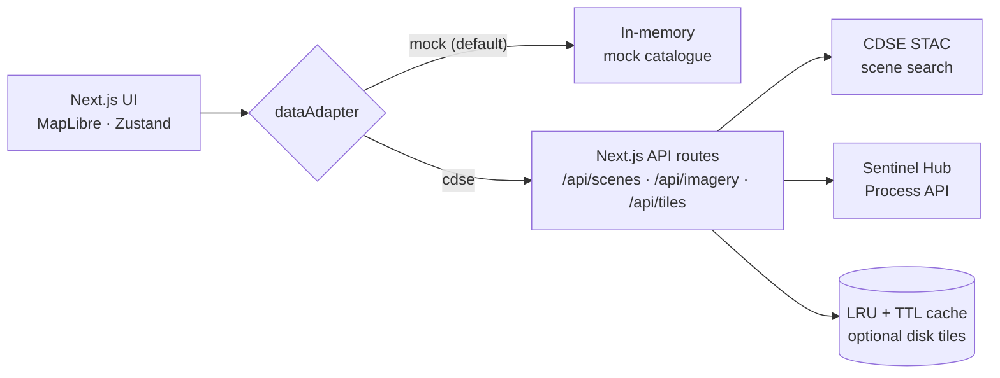

<div align="center">

# 🛰️ Rajasthan Imagery Explorer

**Browse, compare and download Sentinel-2 satellite imagery over Rajasthan, clipped to District → Tehsil → ILR areas.**

[](https://github.com/Vatxsal/rajasthan_satellite_imagery_analysis/actions/workflows/ci.yml)
[](LICENSE)
[](.nvmrc)
[](https://dataspace.copernicus.eu/)


[Quick Start](#-quick-start) · [Features](#-features) · [Connect Copernicus](#-connecting-copernicus-cdse) · [Deploy](#-deploying-to-vercel) · [Troubleshooting](#-troubleshooting)

</div>

<!-- Tip: add a screenshot or GIF here, e.g.
<p align="center"></p>
-->

---

> **Zero-setup demo.** The app runs out of the box on an in-memory mock catalogue, with no backend, database or API keys required. Set `NEXT_PUBLIC_DATA_SOURCE=cdse` to switch to live Copernicus Data Space Ecosystem (Sentinel-2) imagery. See [Connecting Copernicus](#-connecting-copernicus-cdse).

## 📑 Table of Contents

- [Features](#-features)
- [Quick Start](#-quick-start)
- [Architecture](#-architecture)
- [Connecting Copernicus (CDSE)](#-connecting-copernicus-cdse)
- [Change Detection](#-change-detection)
- [Deploying to Vercel](#-deploying-to-vercel)
- [Security & Guard Rails](#-security--guard-rails)
- [Testing & CI](#-testing--ci)
- [Project Layout](#-project-layout)
- [Design Tokens](#-design-tokens)
- [Boundary Data](#-boundary-data-datameet-census-2011)
- [Plugging in a Real DataAdapter](#-plugging-in-a-real-dataadapter)
- [Troubleshooting](#-troubleshooting)
- [Attribution & Data Sources](#-attribution--data-sources)
- [License](#-license)

---

## ✨ Features

| | Feature | What you get |
| :-: | --- | --- |
| 🧭 | **Shell** | 48px top bar (wordmark, selection breadcrumb, theme toggle, user menu), 56px icon rail, 320px contextual panel (collapse with `[`), full-screen map and a docked 148px scene strip. Below 1024px the panel becomes a bottom sheet and the scene strip a swipeable list. |
| 🔎 | **Filters** | District → Tehsil → ILR cascade, date presets (30d / 90d / 6m / Custom), cloud-cover slider with numeric input, composite control (true colour / false colour / NDVI), sticky Search / Reset bar. |
| 🖼️ | **Scenes** | One card per acquisition day (daily mosaic) with thumbnail, cloud % bar, tile count, **coverage % of the selected area** and MGRS tile ids. Sort by lowest cloud or newest, with skeleton and empty states. |
| ⬇️ | **Downloads** | Per-scene menu with 5 deep links into Copernicus Browser / Data Space (per-tile `.SAFE` product ids, date, zoom and view pre-filled), plus true-colour **PNG**, visual **GeoTIFF** and 8-band **analysis GeoTIFF** (FLOAT32 reflectance indices, band descriptions, nodata), all clipped to the selection (≤ 2500 px per side). Copy single or all product ids. |
| 🗺️ | **Map** | OpenFreeMap *positron* vector basemap with an Esri World Imagery switcher, zoom / home / locate / fullscreen controls with screenshot menu, debounced Nominatim address search, selection highlight with `fitBounds`, live cursor coordinates, legend and composite legend. |
| 🛰️ | **Imagery overlay** | Selecting a scene swaps a clipped PNG (transparent outside the AOI) into a MapLibre image source. XYZ tile mode renders native-resolution 512px tiles per pan/zoom, with empty-tile short-circuits (outside area, out-of-band zoom, too many tiles) so quota is only spent on visible, in-area tiles. |
| 🔍 | **Change detection** | Compare two dates (A/B) for the current area: swipe side-by-side of the two acquisitions, classified change map (water / vegetation / bare-built gain & loss) with legend and per-class toggles, class + per-tehsil statistics, top-10 hotspots with one-click zoom, PNG / GeoTIFF / CSV / GeoJSON exports and an optional Gemini plain-language summary. See [Change Detection](#-change-detection). |
| 🧱 | **Layers** | Eye toggles for district / tehsil / ILR boundaries and the imagery overlay (inline opacity slider). Rajasthan state outline with casing lines keeps borders visible on any basemap. |
| 🌗 | **Themes** | Light / dark, persisted. Boundary and selection colours mirror the theme on the map. |
| 📏 | **Measure / Saved queries** | UI shells wired to the store state. |

---

## 🚀 Quick Start

> **Requires Node ≥ 20.9** (Node 20 LTS recommended; `.nvmrc` pins 20).

```bash
npm install
npm run dev        # http://localhost:3000
```

<details>
<summary><b>All available scripts</b></summary>

```bash
npm run build      # production build (type-checks + lints)
npm run start      # serve the production build
npm run lint       # eslint (next/core-web-vitals)
npm run typecheck  # tsc --noEmit
npm test           # unit tests (node --test): downloads, Copernicus links, change detection
npm run generate:mock-data   # regenerate data/mock/*.geojson
node scripts/smoke.browser.cjs   # headless-browser end-to-end smoke (needs Chrome)
```

</details>

---

## 🏗️ Architecture



Components and the store only talk to a single `dataAdapter` singleton, so the data source can be swapped without touching the UI.

---

## 🌍 Connecting Copernicus (CDSE)

Live Sentinel-2 imagery is already wired in. Nothing in the UI changes; you only flip one env var.

### 1. Get credentials

Create a free account at [dataspace.copernicus.eu](https://dataspace.copernicus.eu/), then create an OAuth client under **Dashboard → Account Settings → OAuth clients**. Copy the client ID and secret into `.env.local` (see `.env.example`):

```bash
CDSE_CLIENT_ID=your-client-id
CDSE_CLIENT_SECRET=your-client-secret
NEXT_PUBLIC_DATA_SOURCE=cdse
```

> 🔐 `CDSE_CLIENT_ID` / `CDSE_CLIENT_SECRET` are **server-only** (no `NEXT_PUBLIC_` prefix), so they never reach the browser bundle. This is verified by a build-time bundle scan in the release checklist.

### 2. What happens under the hood

| Concern | Route | Behaviour |
| --- | --- | --- |
| **Adapter** | `lib/data/index.ts` | Picks `cdseAdapter` when `NEXT_PUBLIC_DATA_SOURCE=cdse`. Boundaries still come from local GeoJSON; only scene search and imagery go to CDSE. |
| **Scene search** | `POST /api/scenes` | STAC catalogue query (Sentinel-2 L2A), cloud-cover filtered, grouped into one scene per day with per-tile product ids and coverage math. Areas larger than `MAX_AOI_KM2` are rejected before any quota is spent. |
| **Imagery** | `GET\|POST /api/imagery` | Sentinel Hub Process API render clipped to the polygon (RGBA PNG transparent outside the AOI, or GeoTIFF). Evalscripts live in `lib/cdse/evalscripts.ts`. Responses are cached in-memory (LRU + TTL) keyed by geometry + date + composite + size + format, and served as a **chunked stream** (see [Deploying to Vercel](#-deploying-to-vercel)). |
| **Tiles** | `GET /api/tiles/{z}/{x}/{y}` | One Process render per XYZ tile at native resolution, disk-cached when `TILE_CACHE_DIR` is set (off on Vercel). |
| **Errors** | all routes | Every route returns `{ code, message }`. Auth, config and quota failures map to friendly codes (see [Troubleshooting](#-troubleshooting)). |
| **Health** | `GET /api/health/cdse` | Reports whether a token can be obtained. Never returns secrets. |

### 3. Environment variables

| Variable | Visibility | Required | Default | Purpose |
| --- | --- | :-: | --- | --- |
| `NEXT_PUBLIC_DATA_SOURCE` | public (build-time) | no | `mock` | `mock` = offline demo, `cdse` = live |
| `CDSE_CLIENT_ID` | 🔒 **secret** | yes (cdse) | n/a | OAuth client id (server-only) |
| `CDSE_CLIENT_SECRET` | 🔒 **secret** | yes (cdse) | n/a | OAuth client secret (server-only) |
| `CDSE_TOKEN_URL` | server | no | CDSE identity token endpoint | Override for proxied setups |
| `CDSE_SH_BASE_URL` | server | no | `https://sh.dataspace.copernicus.eu` | Sentinel Hub API base |
| `CDSE_WMTS_INSTANCE_ID` | server | no | unset | Enables the legacy WMTS tile proxy |
| `MAX_AOI_KM2` | server | no | `70000` | Reject areas larger than this (covers all Rajasthan) |
| `IMAGERY_CACHE_TTL_SECONDS` | server | no | `86400` | In-memory imagery/tile cache TTL |
| `RATE_LIMIT_PER_MIN` | server | no | `30` | Per-IP cap for API routes |
| `RATE_LIMIT_TILES_PER_MIN` | server | no | `240` | Per-IP cap for XYZ tiles |
| `DAILY_RENDER_BUDGET` | server | no | `3000` | Daily Process API render cap (UTC day, per instance; `0` = off) |
| `TILE_CACHE_DIR` | server | no | unset | On-disk tile cache (auto-disabled on Vercel) |

---

## 🔍 Change Detection

Compare two Sentinel-2 dates over the selected district / tehsil / ILR and see **what changed**: a swipe side-by-side, a classified change map, per-class and per-tehsil statistics, and the ten largest change patches. Every number comes from the deterministic raster pipeline in `lib/analysis/` — Gemini only puts them into words.

> Requires live data (`NEXT_PUBLIC_DATA_SOURCE=cdse`). In `mock` mode the Analyze call fails fast with `CDSE_CONFIG` instead of spending quota.

### 1. Using it

1. Search an area as usual, then arm **Compare** in the scene-strip header (the strip slims down to the A/B bar — expand it with the chevron to re-pick scenes).
2. Assign **A** and **B** on two different scene cards (a duplicate date is rejected; the server normalises the pair so A is always the earlier date).
3. **Analyze** streams progress (`Fetching date A → Fetching date B → Analyzing`, ~2 Process renders, `maxDuration` 60s). The left sidebar collapses so the map keeps ≥60% of the viewport, and the results panel opens:
   - **Desktop (≥1024px):** a resizable right-hand panel (drag its left edge, or focus it and use ← / →). **Mobile:** a bottom sheet capped at 45vh.
   - **Swipe** — drag the divider (or arrow-key it): date A on the left, date B on the right, two synchronized MapLibre maps.
   - **Change map** — classified overlay with legend, per-class visibility, opacity slider, **Boost visibility** (display-only dilation + contrast outline so small patches stay visible), **Zoom to changes**, and **PNG** / **GeoTIFF** export (uint8, nodata 255 — opens in QGIS). After a run the map auto-frames the analysed bbox.
   - **Statistics** — totals, class breakdown, per-tehsil table (district-level runs; click a row to highlight that tehsil on the map, optional alpha **choropleth** shading), applied thresholds, sensitivity / minimum-patch re-run, **CSV** export.
   - **Hotspots** — top-10 surviving patches as numbered map polygons + markers; hovering the list highlights the patch on the map and vice versa, clicking zooms to the patch and opens a popup (copy-coords). Export the list as **GeoJSON** (patch polygons where traceable).
   - **Summary** — an optional server-side Gemini briefing (English or हिन्दी) of the deterministic statistics, with three ≤768 px preview images (date A, date B, overlay-on-B) the server renders itself. You choose the language and whether to attach previews (privacy note in the tab); only the analysis cache key + whitelisted numbers ever leave the server for the text itself.

Changing the area or running a new search clears the pair (the old polygons no longer apply). Results are LRU-cached (`IMAGERY_CACHE_TTL_SECONDS`) — re-opening a finished pair replays instantly without new renders.

### 2. How it works

| Step | Where | What happens |
| --- | --- | --- |
| **Fetch** | `lib/analysis/fetch.ts` | One 5-band FLOAT32 Process render per date (NDVI, MNDWI, NDBI, valid, dataMask) clipped to the polygon, grid capped at `COMPARE_MAX_PX` px on the long side. |
| **Mask** | `lib/analysis/mask.ts` | Polygon scanline mask + 1-px invalid-data dilation (snapshot-seeded, no cascade). |
| **Classify** | `lib/analysis/classify.ts` | Index differencing with fixed precedence: water gain → water loss → vegetation loss → vegetation gain → bare/built increase. |
| **Clean** | `lib/analysis/filter.ts` | 3×3 majority filter, then 8-connected minimum mapping unit (default 0.2 ha). |
| **Stats** | `lib/analysis/stats.ts` | Per-class areas, valid %, per-tehsil zonal breakdown (district-level), top-10 patch hotspots with GeoJSON polygons + change bbox. |
| **Summary** | `lib/server/gemini.ts` + `lib/server/summaryImages.ts` | Structured-output Gemini call (zod-validated, one retry on 429/5xx) with optional ≤768 px JPEG previews rendered from the tile cache — never raw pixels. |
| **Routes** | `app/api/compare/` | `POST analyze` streams NDJSON progress + result · `GET overlay` serves the classified PNG / GeoTIFF · `POST summary` returns the structured Gemini summary. |
| **UI** | `components/compare/` | `store/useCompareStore.ts` + `lib/compare/bridge.ts` drive the overlay, hotspot/tehsil/choropleth layers and date-A tiles on the main map; the swipe view is a second non-interactive maplibre instance with one-way camera sync. |

Rate limits: `compare` bucket (default 6/min) for analyze, `ai` bucket (default 5/min) for the summary. CSP is unchanged — Gemini is called server-side.

### 3. Thresholds

Tunables live in **one file** — `lib/analysis/config.ts` — and every run echoes the applied values in its metadata:

| Signal | Rule | Meaning |
| --- | --- | --- |
| ΔMNDWI ≥ +0.20 and MNDWI(after) > 0 | Water gain |
| ΔMNDWI ≤ −0.20 and MNDWI(before) > 0 | Water loss |
| ΔNDVI ≤ −0.15 | Vegetation loss |
| ΔNDVI ≥ +0.15 | Vegetation gain |
| ΔNDBI ≥ +0.10 and ΔNDVI ≤ −0.05 | Bare / built-up increase |

**Sensitivity** scales every threshold: `low` ×1.5 (conservative) · `medium` ×1 · `high` ×0.7. **Minimum patch** defaults to 0.2 ha (0.01–100). These are documented heuristics, not physics — Rajasthan's irrigated cropland and kharif cycles move the indices — and the scenario is the ground truth (no published truth set exists for this product). Valid data below 70% triggers a warning in the UI.

### 4. Environment variables (set these alongside the CDSE ones)

| Variable | Visibility | Required | Default | Purpose |
| --- | --- | :-: | --- | --- |
| `COMPARE_MAX_PX` | server | no | `1500` | Long-side cap of the analysis grid (smaller = faster, coarser) |
| `COMPARE_RATE_LIMIT_PER_MIN` | server | no | `6` | Per-IP cap for `POST /api/compare/analyze` |
| `AI_SUMMARY_RATE_LIMIT_PER_MIN` | server | no | `5` | Per-IP cap for `POST /api/compare/summary` |
| `GEMINI_API_KEY` | 🔒 **secret** | no | unset | Enables the Summary tab (server-side only; without it the tab shows a setup hint) |
| `GEMINI_MODEL` | server | no | `gemini-3.8-flash` | Gemini model used for the summary |

---

## ▲ Deploying to Vercel

1. **Import** the repo from GitHub into Vercel (framework auto-detected as Next.js; no extra build settings needed).
2. **Add env vars** from the table above: `NEXT_PUBLIC_DATA_SOURCE=cdse` (public) plus `CDSE_CLIENT_ID` / `CDSE_CLIENT_SECRET` (sensitive). Optionally add `GEMINI_API_KEY` (sensitive, see [Change Detection](#-change-detection)) to enable AI summaries. Leave `TILE_CACHE_DIR` unset: serverless disks are ephemeral, and the app disables the disk cache automatically when `process.env.VERCEL` is set.
3. **Region**: `vercel.json` pins the function region to **`fra1`** (Frankfurt) to keep the server ↔ Copernicus round-trip short. Build output stays default.
4. **Deploy.** Function `maxDuration` is exported per route (60s for renders, 30s for health); the default streaming runtime is used.

> 📦 **Large downloads.** Vercel caps buffered function responses at 4.5 MB, but *streamed* responses are exempt. `/api/imagery` therefore always responds with `Transfer-Encoding: chunked` and no `Content-Length`, which keeps multi-MB PNG/GeoTIFF downloads working on the Hobby plan.

> ⚠️ **Rate limiting and budget are per instance.** In-memory counters reset on cold starts and are not shared between instances, so they protect against runaway usage rather than acting as a global quota. The CDSE-side quota remains the real limit.

### ✅ Post-deploy checklist

```bash
curl -s https://<your-app>.vercel.app/api/health/cdse        # {"status":"ok",...}
curl -sI https://<your-app>.vercel.app/ | grep -i content-security-policy
node scripts/smoke.browser.cjs                               # BASE_URL=https://<your-app>.vercel.app
```

Then in the browser:

- [ ] Pick a district → **Search imagery**
- [ ] Select a scene (imagery overlay appears)
- [ ] Open a scene's menu → download PNG
- [ ] Switch basemap → search an address
- [ ] No console errors, no CSP violations

---

## 🛡️ Security & Guard Rails

| Area | Protection |
| --- | --- |
| **Secrets** | Server-only env vars are validated by zod (`lib/env.ts`) and never imported into client components. The production client bundle is scanned for credential values before release. |
| **Headers** | Content-Security-Policy plus `X-Content-Type-Options`, `X-Frame-Options`, `Referrer-Policy`, `Permissions-Policy` and HSTS on all routes (`next.config.mjs`). The CSP allow-lists only `self`, OpenFreeMap, Esri and Nominatim (MapLibre requires `worker-src blob:` and `script-src 'unsafe-eval'` for its expression compiler). |
| **CSRF** | POST routes reject requests whose `Origin` header points at another host (`403 CROSS_ORIGIN`). Rate limiting and validation cover non-browser clients. |
| **Input limits** | zod schemas on every route. JSON bodies capped at 512 KB (`413`), invalid JSON → `400`, geometry / date / enum fields strictly validated. |
| **Quota** | Per-IP fixed-window rate limits (API + tile buckets) and a daily render budget (`DAILY_RENDER_BUDGET`) with a `429` contract. Upstream fetches have 20-60s timeouts so a hung Copernicus call cannot pin a function. |

<details>
<summary><b>Dependency audit</b></summary>

`npm audit` reports 13 advisories that only resolve with major upgrades (Next 16 / MapLibre 6 / Tailwind 4 / eslint-config-next 15). None are reachable at runtime here:

- The Next advisory concerns `next/image` (not used).
- The MapLibre advisory concerns HTML sanitisation sinks (the app renders no map HTML popups).
- The rest are build-time tooling.

Re-evaluate on the next major upgrade.

</details>

---

## 🧪 Testing & CI

```bash
npm run typecheck   # tsc --noEmit
npm run lint        # next lint
npm test            # compiles tsconfig.test.json → node --test (19 tests)
npm run build       # production build incl. type + lint pass
node scripts/smoke.browser.cjs   # full browser flow: map, basemap switch,
                                 # address search, scene search, streamed
                                 # imagery, CSP enforcement (requires Chrome)
```

`.github/workflows/ci.yml` runs on every push/PR to `main` with `NEXT_PUBLIC_DATA_SOURCE=mock` (no secrets needed):

```text
install → typecheck → lint → test → build → boot prod server → smoke-test "/" and "/api/health/cdse"
```

---

## 🗂️ Project Layout

```text
app/
  api/
    scenes/             # POST: STAC search → daily mosaic scenes (zod, origin guard)
    imagery/            # GET|POST: clipped PNG/GeoTIFF render (streamed)
    tiles/[z]/[x]/[y]   # XYZ tile render + WMTS proxy + empty-tile short-circuits
    compare/            # analyze (NDJSON stream), overlay (PNG/GeoTIFF), summary (Gemini)
    health/cdse/        # credential/token health (no secrets)
  layout.tsx, page.tsx, globals.css
components/
  shell/                # TopBar, Rail, Panel, ThemeSync
  filters/              # FiltersPanel, DateCalendar, MeasurePanel, SavedQueriesPanel
  layers/               # LayersPanel, Legend
  map/                  # MapCanvas + controls, address search, basemap switcher, legends
  scenes/               # SceneStrip, SceneCard, ProductDialog (ids/links), DownloadDialog
  compare/              # CompareBar, CompareDrawer, CompareStatsTab, CompareMapController
  ui/                   # Button, Select, Slider, Segmented, Chip, Tooltip, Menu, ToastStack
data/
  boundaries/           # real Rajasthan district/tehsil GeoJSON (Datameet, Census 2011)
  mock/                 # hand-made demo GeoJSON (districts, tehsils, ILRs)
lib/
  cdse/                 # auth (OAuth token), STAC catalog, Process API, evalscripts,
                        # GeoTIFF metadata patcher, geometry/tiling maths, WMTS
  analysis/             # change-detection engine (evalscript, classify, filters, stats,
                        # PNG/GeoTIFF encoders, prompt) — pure modules, unit-tested
  compare/              # client helpers: NDJSON stream, map bridge, recolour, exports
  data/                 # DataAdapter interface + mock/cdse adapters, boundaries, types
  server/               # API helpers (errors, origin guard, body caps, streams),
                        # area resolution, daily render budget
  map/                  # basemap definitions, palettes, geojson helpers
  hooks/                # useAreas, useMediaQuery
  cache.ts              # in-memory LRU + optional disk tile cache
  rateLimit.ts          # fixed-window per-IP limiter (api | tiles | compare | ai buckets)
  env.ts                # zod-validated server env loader
  downloads.ts          # download formats + filename builders
  copernicusBrowser.ts  # Copernicus Browser/Data Space deep-link builder
store/                  # Zustand stores (app state, compare state + persisted theme)
scripts/                # mock-data generator, Datameet fetcher, unit + smoke tests
.github/workflows/      # CI
```

---

## 🎨 Design Tokens

Tokens live as CSS variables in `app/globals.css` and are mirrored into the Tailwind theme in `tailwind.config.ts` (RGB triplets, so opacity modifiers like `bg-surface/90` work). The dark theme is applied via `<html data-theme="dark">`.

| Token | Light | Dark |
| --- | --- | --- |
| `--bg` | `#F6F5F1` | `#14151A` |
| `--surface` | `#FFFFFF` | `#1C1E24` |
| `--surface-2` | `#EFEDE7` | `#23262D` |
| `--border` | `#DAD7CF` | `#2E323B` |
| `--text` | `#1B1D22` | `#E8E6E1` |
| `--text-muted` | `#6B6E76` | `#9A9DA6` |
| `--accent` | `#C2410C` (terracotta) | `#F0713A` |
| `--accent-soft` | `#FBE9E0` | `#33221B` |
| `--accent-fg` | `#FFFFFF` | `#14151A` |
| `--success` / `--warning` / `--danger` | `#2F7D5B` / `#B7791F` / `#B42318` | `#4EA37B` / `#D6A04A` / `#E4574B` |

**Conventions:** 6px radius for inputs/buttons, 8px for panels, 1px hairline borders, a single subtle shadow for floating map controls, Public Sans for UI and IBM Plex Mono (tabular numerals) for coordinates, dates and scene IDs, and a 12/13/14/16/20px type scale.

Map overlays cannot read CSS variables, so their colours are mirrored per theme in `lib/map/palette.ts` (accent line 2px + 10% fill for the selection, text-coloured district/tehsil boundaries with solid/dashed styles, muted dotted ILRs, accent dashed scene footprint). Line style always differs so colour is never the only signal.

<details>
<summary><b>Changing the accent colour</b></summary>

1. Update `--accent`, `--accent-soft` and `--accent-fg` in both `:root` (light) and `[data-theme="dark"]` in `app/globals.css` (use RGB triplets, e.g. `--accent: 194 65 12;`).
2. Mirror the accent in `lib/map/palette.ts` (`MAP_PALETTES.light.accent` and `MAP_PALETTES.dark.accent`).

No other files need to change. Tailwind utilities (`text-accent`, `bg-accent`, …) read the variables directly.

</details>

---

## 🧭 Boundary Data (Datameet, Census 2011)

The app prefers real Rajasthan boundaries from [Datameet](https://datameet.org)'s Census 2011 compilations. To (re)fetch them (network download, **not** part of the build):

```bash
npx tsx scripts/fetch-datameet.ts
```

It downloads district TopoJSON from [`datameet/indian-district-boundaries`](https://github.com/datameet/indian-district-boundaries) and taluk shapefiles from [`datameet/taluk_boundaries`](https://github.com/datameet/taluk_boundaries), filters to Rajasthan, simplifies geometry and writes `data/boundaries/districts.geojson` and `data/boundaries/tehsils.geojson`.

The adapter falls back to the hand-made mock boundaries while those files are empty. ILR units come from `data/mock/ilrs.geojson` until real ILR data is added.

---

## 🔌 Plugging in a Real DataAdapter

All data access goes through one interface ([`lib/data/adapter.ts`](lib/data/adapter.ts)):

```ts
export interface DataAdapter {
  getDistricts(): Promise<District[]>;
  getTehsils(districtId: string): Promise<Tehsil[]>;
  getIlrs(tehsilId: string): Promise<Ilr[]>;
  searchScenes(params: SearchParams): Promise<Scene[]>;
}
```

Components and the store only import the `dataAdapter` singleton from [`lib/data/index.ts`](lib/data/index.ts). Two implementations ship: `mockAdapter` (in-memory demo) and `cdseAdapter` (calls the `/api` routes above).

To add another (PostGIS, Supabase, a different STAC…), implement the interface and swap the singleton in that one file. Everything downstream (cascading selects, scene strip, `runSearch`, boundary layers) keeps working.

---

## 🩺 Troubleshooting

| Symptom | `code` | Fix |
| --- | --- | --- |
| Search/download fails immediately | `RATE_LIMITED` | Per-IP limit hit. Wait for `Retry-After` or raise `RATE_LIMIT_PER_MIN` |
| Renders stop after heavy use | `DAILY_BUDGET_EXCEEDED` | Raise `DAILY_RENDER_BUDGET` (resets 00:00 UTC) |
| "Area too large" | `AOI_TOO_LARGE` | Pick a tehsil/ILR or raise `MAX_AOI_KM2` |
| Download rejected | `DOWNLOAD_TOO_LARGE` | Requested px > 2500. Pick a smaller area |
| `cdse` mode, everything 500s | `CDSE_CONFIG` | Set `CDSE_CLIENT_ID` / `CDSE_CLIENT_SECRET` in `.env.local` (or Vercel env) |
| Auth failures | `CDSE_AUTH` / 401 | Recreate the OAuth client; check for trailing whitespace |
| Upstream failures | `UPSTREAM_ERROR` (502) | Copernicus outage/timeout. Retry shortly |
| Tiles 404 | `WMTS_DISABLED` | Expected: legacy WMTS mode needs `CDSE_WMTS_INSTANCE_ID`; native mode needs `?date=&areaId=&level=` |
| Analyze refused in mock mode | `CDSE_CONFIG` (400) | Change detection needs `NEXT_PUBLIC_DATA_SOURCE=cdse` with CDSE credentials |
| "No Sentinel-2 scene on \<date\>" | `COMPARE_NO_SCENE` (404) | Nothing over that area on the chosen day — pick another date |
| Export fails after a while | `OVERLAY_NOT_FOUND` (404) | The result aged out of the LRU cache — run the analysis again |
| AI summary unavailable | `AI_DISABLED` (503) | Set `GEMINI_API_KEY` (server-only) and redeploy; the card is hidden without it |
| `npm run dev` exits with `EADDRINUSE` | n/a | Another process holds :3000 (e.g. a stale server). Stop it or use `npm run dev -- -p 3001` |

---

## 📜 Attribution & Data Sources

| Source | Credit |
| --- | --- |
| **Sentinel-2 data** | © ESA / Copernicus data via the [Copernicus Data Space Ecosystem](https://dataspace.copernicus.eu/), subject to the Copernicus licensing terms. Include attribution when republishing imagery. |
| **Basemaps** | [OpenFreeMap](https://openfreemap.org/) *positron* style (OpenMapTiles / © OpenStreetMap contributors, ODbL) and [Esri World Imagery](https://www.esri.com/en-us/what-is-gis/overview) (Esri, Maxar, Earthstar Geographics). Keep the attribution line visible when publishing screenshots. |
| **Geocoding** | [Nominatim](https://nominatim.org/) search, © OpenStreetMap contributors, ODbL. Usage follows their usage policy. |
| **Boundaries** | [Datameet](https://datameet.org) Census 2011 compilations (Census of India open data). Credit Datameet / Census of India. |
| **Libraries** | [MapLibre GL JS](https://maplibre.org/) (BSD-3-Clause), [Next.js](https://nextjs.org/) (MIT), [zod](https://zod.dev/) (MIT), [turf](https://turfjs.org/) (MIT), Radix UI (MIT), lucide (ISC). UI fonts: Public Sans & IBM Plex Mono (SIL OFL), bundled Geist fonts (MIT). |

---

## 📄 License

Released under the [MIT License](LICENSE) © Vatsal Mishra

<div align="center">

<sub>Built with Next.js, MapLibre and Copernicus Sentinel-2 data · Made for Rajasthan 🇮🇳</sub>

</div>
