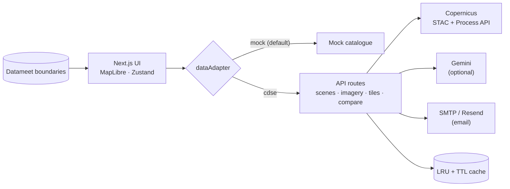

<div align="center">

# 🛰️ Rajasthan Imagery Explorer

**Browse, compare and download Sentinel-2 imagery over Rajasthan, clipped to District → Tehsil → ILR areas, see what changed between two dates, and email the report.**

[](https://github.com/Vatxsal/rajasthan_satellite_imagery_analysis/actions/workflows/ci.yml)
[](LICENSE)
[](.nvmrc)
[](https://dataspace.copernicus.eu/)

Next.js 14 · TypeScript · Tailwind · MapLibre GL JS · Zustand · Radix UI · zod · Nodemailer

[Quick Start](#-quick-start) · [Features](#-features) · [Configuration](#-configuration) · [Change Detection](#-change-detection) · [Email Report](#-email-report) · [Deploy](#-deploy-to-vercel) · [Roadmap](#-roadmap) · [Troubleshooting](#-troubleshooting)

</div>

<!-- Add screenshots to docs/screenshots and uncomment:
<p align="center"></p>
-->

> **Zero-setup demo.** With defaults the app runs on an in-memory mock catalogue: no keys, database or backend. Set `NEXT_PUBLIC_DATA_SOURCE=cdse` for live Copernicus imagery.

---

## ✨ Features

| | Feature | What you get |
| :-: | --- | --- |
| 🔎 | **Filters & scenes** | District → Tehsil → ILR cascade, date presets and a calendar that highlights dates with scenes, cloud slider, true / false colour / NDVI. One card per acquisition day with cloud %, **coverage % of the area**, UTC time and scene id. |
| 🗺️ | **Map & imagery** | OpenFreeMap basemap (English labels) with an Esri satellite switcher, **native-resolution 512 px tiles** (bicubic upscaling, zoom band up to z15) clipped to the selected area, opacity slider, legends, address search, boundary layers, light / dark themes. |
| ⬇️ | **Downloads** | PNG preview; **GeoTIFF (visual, 8-bit)** that opens correctly anywhere; **GeoTIFF (analysis, FLOAT32 bands)** for processing; Copernicus Browser deep links with per-tile `.SAFE` ids. Clipped to the selection, up to 2500 px per side with a reduced-resolution option. |
| 🔍 | **Change detection** | Compare two dates: **Swipe**, classified **Changes** map, **Stats** (by class and tehsil), **Events** list with numbered map markers, **Summary**, and PNG / GeoTIFF / CSV / GeoJSON exports. |
| 🤖 | **AI summary** | Optional Gemini briefing of a comparison in English or हिन्दी, built only from the computed statistics. |
| 📧 | **Email report** | One click (**Send report to mail**) emails the top events, stats, AI summary, change-map image, `events.csv` and a link that reopens the analysis. Fixed-recipient mode for production. |
| 🔐 | **Access gate & landing** | `/login` hero page with shared-credential **Sign in**, **Continue as guest**, and an in-card **Request access** form that emails the admin. Email deep links survive the login bounce. |

---

## 🚀 Quick Start

> Requires **Node ≥ 20.9** (`.nvmrc` pins 20).

```bash
git clone https://github.com/Vatxsal/rajasthan_satellite_imagery_analysis.git
cd rajasthan_satellite_imagery_analysis
npm install
cp .env.example .env.local     # PowerShell: Copy-Item .env.example .env.local
npm run dev                    # http://localhost:3000
```

<details>
<summary><b>Scripts</b></summary>

```bash
npm run verify         # typecheck + lint + test + build (what CI runs)
npm run build / start  # production build / serve it
npm run lint / typecheck / test
npm run email:preview  # render email fixtures to .email-preview/
npm run email:test     # send one test report to EMAIL_TEST_RECIPIENT
npm run auth:new-user  # mint an SSO entry: password printed once, JSON for SSO_USERS
npm run auth:hash      # hash a password for an existing SSO_USERS entry (argv or stdin)
npx tsx scripts/fetch-datameet.ts   # (re)download boundaries (not part of the build)
node scripts/smoke.browser.cjs      # headless-browser smoke test (needs Chrome)
node scripts/sharpness.browser.cjs      # imagery sharpness evidence (bicubic z13–15; needs Chrome)
node scripts/verify-swipe-basemap.browser.cjs  # Swipe dates/basemap mode harness (needs Chrome)
```

</details>

---

## 🏗️ Architecture



All Copernicus, Gemini and email calls are **server-side**; the browser never sees a credential. Swapping the data source only means swapping the `dataAdapter` singleton.

**Outbound access** (for firewalls and government hosting):

| Service | From | Used for | Needed |
| --- | --- | --- | --- |
| `identity.dataspace.copernicus.eu`, `sh.dataspace.copernicus.eu` | server | token, scene search, renders | yes (live mode) |
| OpenFreeMap, Esri World Imagery, Nominatim | browser | basemap, satellite basemap, address search | yes (or self-host) |
| Google Gemini API | server | AI summary | optional |
| Your SMTP host or Resend | server | email report | optional |
| `challenges.cloudflare.com` | browser + server | Turnstile CAPTCHA | optional |

---

## ⚙️ Configuration

`.env.example` is the source of truth and mirrors `lib/env.ts` (validated by zod; missing server vars produce a clear error).

| Variable | Type | Default | Purpose |
| --- | :-: | --- | --- |
| `NEXT_PUBLIC_DATA_SOURCE` | public | `mock` | `mock` or `cdse` |
| `NEXT_PUBLIC_SITE_URL` | public | n/a | Canonical site URL used in email links. No trailing slash. |
| `CDSE_CLIENT_ID` / `CDSE_CLIENT_SECRET` | 🔒 | n/a | Copernicus OAuth client (required in `cdse` mode) |
| `CDSE_TOKEN_URL` / `CDSE_SH_BASE_URL` / `CDSE_WMTS_INSTANCE_ID` | server | CDSE defaults / unset | Overrides and legacy WMTS mode |
| `MAX_AOI_KM2` | server | `70000` | Reject larger areas before spending quota |
| `IMAGERY_CACHE_TTL_SECONDS` | server | `86400` | In-memory cache TTL |
| `RATE_LIMIT_PER_MIN` / `RATE_LIMIT_TILES_PER_MIN` | server | `30` / `240` | Per-IP limits |
| `DAILY_RENDER_BUDGET` | server | `3000` | Daily render cap per instance (`0` = off) |
| `TILE_CACHE_DIR` | server | unset | Disk tile cache (auto-off on Vercel) |
| `COMPARE_MAX_PX` / `COMPARE_RATE_LIMIT_PER_MIN` | server | `1500` / `6` | Analysis grid cap and analyze limit |
| `PER_ANALYSIS_PU_LIMIT` | server | `700` | PU cap per analysis, estimated before fetching (`0` = off) |
| `CHANGE_RULES` / `CHANGE_ENGINE` | server | `fused` / `v1` | Change-rule mode: `legacy`, `fused` or `ml`; `CHANGE_ENGINE` picks v1/v2 for `legacy` only |
| `S1_ENABLED` / `S1_WINDOW_DAYS` | server | `true` / `6` | Sentinel-1 GRD evidence for fused/ml rules and its ±day temporal median |
| `WORLDCOVER_ENABLED` | server | `true` | ESA WorldCover 2021 land-cover prior (free COG reads, no PU cost) |
| `SHARPEN_SWIR` | server | `false` | Opt-in regression sharpening of the 20 m SWIR bands (B11/B12) before index computation; changes NDBI/MNDWI/BSI, so it flips the compare cache key |
| `ML_MODEL_PATH` | server | `artifacts/ml/model.json` | Trained model for `CHANGE_RULES=ml` (missing → `CDSE_ML_MODEL_MISSING`) |
| `GEMINI_API_KEY` | 🔒 | unset | Enables the Summary tab |
| `GEMINI_MODEL` / `AI_SUMMARY_RATE_LIMIT_PER_MIN` | server | `gemini-2.5-flash` / `5` | Model (must be in the key's ListModels) and limit |
| `EMAIL_PROVIDER` | server | `console` | `console` (dev only), `smtp` or `resend` |
| `EMAIL_FROM` | server | n/a | `Rajasthan Imagery Explorer <address>`; must match the SMTP user / verified sender |
| `SMTP_HOST` / `SMTP_PORT` / `SMTP_SECURE` / `SMTP_USER` | server | n/a | SMTP settings |
| `SMTP_PASS` / `RESEND_API_KEY` | 🔒 | n/a | Provider secret |
| `EMAIL_FIXED_RECIPIENT` | 🔒 | unset | Pins every report to one server-side address |
| `EMAIL_ALLOW_ANY_RECIPIENT` | server | `false` | Allow typed-address mode in production (leave off) |
| `EMAIL_DAILY_CAP` / `EMAIL_RATE_LIMIT_PER_ADDRESS_PER_DAY` / `EMAIL_RATE_LIMIT_PER_IP_PER_DAY` | server | `80` / `3` / `10` | Email quotas (UTC day, per instance) |
| `TURNSTILE_SITE_KEY` / `TURNSTILE_SECRET_KEY` | server / 🔒 | unset | Optional CAPTCHA; set **both or neither** |
| `EMAIL_TEST_RECIPIENT` | dev | unset | Target for `npm run email:test` |
| `AUTH_REQUIRED` | server | `true` in prod / `false` in dev | Gate every route behind the session cookie (`""` = default) |
| `SESSION_SECRET` | 🔒 | n/a | HS256 secret, 32+ chars; required to sign/verify sessions; rotation signs everyone out |
| `SSO_USERS` | 🔒 | unset | JSON array of shared-credential users (build with `npm run auth:new-user`) |
| `GUEST_ENABLED` | server | `true` | Allow **Continue as guest** sessions |
| `SESSION_TTL_GUEST_HOURS` / `SESSION_TTL_SSO_HOURS` | server | `12` / `168` | Session lifetimes |
| `AUTH_GUEST_PER_IP_PER_HOUR` | server | `20` | Guest sessions per IP per hour |
| `ACCESS_REQUEST_PER_IP_PER_DAY` / `ACCESS_REQUEST_DAILY_CAP` | server | `3` / `10` | Access-request quotas (UTC day; cap `0` hides the form) |

🔒 = secret. On Vercel mark secrets **Sensitive**, keep `NEXT_PUBLIC_*` as **Config** (Vercel refuses to hide public values), paste values **without quotes**, and redeploy after every change.

### Connect Copernicus (free)

1. Register at [dataspace.copernicus.eu](https://dataspace.copernicus.eu/).
2. Open the **Sentinel Hub dashboard** (<https://shapps.dataspace.copernicus.eu/dashboard/>) → Account Settings → **OAuth clients** → Create.
3. Copy the client ID and secret immediately (the secret is shown once) into `.env.local` and set `NEXT_PUBLIC_DATA_SOURCE=cdse`.
4. Restart and open `/api/health/cdse`. You want `{"status":"ok"}`.

> Create the client in the **Sentinel Hub dashboard**, not on the identity "Applications" page, or you will get `invalid_client` / 401.

**Quota:** renders are metered in processing units (PU). In our testing a tile is ~0.14 PU, a browsing session ~8 to 12 PU, a tehsil GeoTIFF ~2 to 3 PU, and a change analysis is 2 renders. Check your real monthly allowance in the dashboard. The app protects it with caching, a zoom band of 7 to 14, empty-tile short-circuits, `MAX_AOI_KM2`, rate limits and `DAILY_RENDER_BUDGET`.

---

## 🔍 Change Detection

Compare two Sentinel-2 dates over the selected district / tehsil / ILR. Every number comes from the deterministic raster pipeline in `lib/analysis/`; Gemini only phrases the results. Needs live data (`cdse`).

**Use it:** search an area → arm **Compare** in the scene strip → pick **A** and **B** on two scene cards (the server orders them so A is earlier) → **Analyze**. The results panel (right side on desktop, bottom sheet on mobile, resizable) has:

- **Swipe**: date A left, date B right on two synchronised maps — or switch the right side to the **Satellite basemap** (labelled as being from a different date).
- **Changes**: classified overlay, per-class toggles, opacity, *Boost visibility* (display-only), *Zoom to changes*, PNG / GeoTIFF export.
- **Stats**: totals, class table, per-tehsil table (click to highlight, optional shading), and a **Method & settings** card (resolution, valid data, scenes, sensitivity and minimum patch re-run, rules mode, SAR orbit/window, WorldCover prior, terrain mask, thresholds in collapsible sections), CSV export.
- **Events**: surviving change patches, largest first, with sub-labels (e.g. *likely harvest*), confidence tiers (0–100 %, default **Medium+** filter), numbered map markers and a themed popup; GeoJSON export.
- **Summary**: AI briefing (below).

Results are cached; if the cache has expired the server **recomputes from the analysis parameters**, so the tabs and exports keep working.

**Pipeline:** fetch NDVI / MNDWI / NDBI for each date (clouds, shadows and no-data masked) → classify with fixed precedence → 3×3 majority filter and a minimum mapping unit (0.2 ha) → statistics, per-tehsil zonal stats and events.

| Rule | Class |
| --- | --- |
| ΔMNDWI ≥ +0.20 and MNDWI(after) > 0 | Water gain |
| ΔMNDWI ≤ −0.20 and MNDWI(before) > 0 | Water loss |
| ΔNDVI ≤ −0.15 | Vegetation loss |
| ΔNDVI ≥ +0.15 | Vegetation gain |
| ΔNDBI ≥ +0.10 and ΔNDVI ≤ −0.05 | Bare / built-up increase |

Thresholds live in `lib/analysis/config.ts`; **sensitivity** scales them (low ×1.5, medium ×1, high ×0.7). They are heuristics: treat events as places to check, not confirmed changes. Valid data below 70% triggers a warning.

### 🧪 Evidence, rules & confidence

`CHANGE_RULES` (default **fused**) chooses the classifier:

- **legacy** — the shipped thresholds above (`CHANGE_ENGINE` picks v1 or v2).
- **fused** — every candidate patch is scored against up to three free evidence layers fetched alongside the optical run: a Sentinel-1 GRD water/roughness median (`S1_ENABLED`, ±`S1_WINDOW_DAYS` days, one orbit direction per side), the ESA WorldCover 2021 land-cover prior before date A (`WORLDCOVER_ENABLED`), and a Copernicus DEM hillshade-shadow mask. Patches get a 0–100 confidence (high ≥ 75, medium ≥ 55) and a sub-label such as *likely harvest* or *seasonal water loss*.
- **ml** — a softmax model trained on synthetic reference scenes over the same features: `npm run features` then `python ml/train.py` writes `artifacts/ml/model.json` (or `ML_MODEL_PATH`); without a model the API fails with `CDSE_ML_MODEL_MISSING`.

Confidence and sub-labels surface in the events list (default **Medium+** filter), the map popup, the **Method & settings** card (rules mode, SAR orbit and date window, WorldCover on/off, terrain mask), the email report and the AI summary. The evidence layers ride the existing CDSE and WorldCover endpoints — no new services, graceful fallback to optical-only when a layer is unavailable.

### 🤖 AI Summary (Gemini)

1. Create a free key in [Google AI Studio](https://aistudio.google.com/) → `GEMINI_API_KEY` (Sensitive on Vercel).
2. Check `/api/health/gemini`: you want `{"ok":true,"model":"…"}`. Without a key the Summary tab shows a setup hint.

The model narrates the computed numbers and must not invent places or causes. You choose whether to attach three small preview images (≤768 px); a failure with images offers **Try without images**. Output is schema-validated, cached and labelled AI-generated. Some Gemini models have very small free daily quotas, which is why the default is `gemini-2.5-flash`.

**Privacy:** the statistics and optional images of public Sentinel-2 data go to the Gemini API from the server; no user data is sent. Free-tier data terms differ from paid terms, so for sensitive deployments use a paid tier or leave the key unset.

---

## 📧 Email Report

A button in the results panel header (**Send report to mail** in fixed mode, **Email report** in typed mode) sends one auto-generated email containing: the top events, statistics, optional AI summary, an inline change-map image, an `events.csv` attachment, and a **link that reopens the same analysis** (`?a=…&l=…&A=…&B=…&tab=events`). The email states that it is automatically generated by the Rajasthan Imagery Explorer website and must not be replied to.

**Setup (Gmail, free, fine for a few reports a day):**

1. On the sending Gmail account turn on 2-Step Verification and create an **App password** (use 16 characters, no spaces). Prefer a dedicated account.
2. Set `EMAIL_PROVIDER=smtp`, `SMTP_HOST=smtp.gmail.com`, `SMTP_PORT=465` + `SMTP_SECURE=true` (or `587` + `false`), `SMTP_USER`, `SMTP_PASS`, `EMAIL_FROM="Rajasthan Imagery Explorer <same address as SMTP_USER>"`, `NEXT_PUBLIC_SITE_URL`.
3. Test with `npm run email:preview`, then `EMAIL_TEST_RECIPIENT=… npm run email:test`.

Other providers: `resend` (free tier; needs a verified domain to send to others) or any institutional SMTP relay using the same `SMTP_*` fields. `console` never sends and is refused in production.

**Recipient modes**

| Mode | How | Notes |
| --- | --- | --- |
| **Fixed recipient** (production) | `EMAIL_FIXED_RECIPIENT=address` | One-click confirm dialog with a masked hint (`m***@gmail.com`). The browser can never choose a recipient (a body with `email` is rejected). |
| **Typed address** | leave `EMAIL_FIXED_RECIPIENT` unset | Dev and demo. In production it is refused unless `EMAIL_ALLOW_ANY_RECIPIENT=true`. |

**Guard rails:** same-origin check, per-IP and daily quotas (`429` with the next reset time, 05:30 IST), honeypot, optional Turnstile (fail-closed), 10-minute duplicate suppression (no quota used), HTML ≤ 100 KB, CSV ≤ 1 MB, no CR/LF in the subject, addresses never logged (SHA-256 prefix only), nothing stored. If the AI summary fails the email still goes out without it.

**Abuse trade-off:** on a public site anyone can press the button until the daily cap is used. Turnstile, the per-IP limit, the cap and the duplicate guard bound it. Counters are in-memory per serverless instance (cold starts reset them); a durable store such as Upstash / Vercel KV is the upgrade path. Manual QA notes: `docs/email-qa.md`.

---

## 🔐 Authentication & access

Production runs behind a session gate (`middleware.ts`, Edge, jose-verified `rse_session` cookie — httpOnly, SameSite=Lax, Secure in production). Three states, read from `AUTH_REQUIRED` + `SESSION_SECRET`:

| State | Behaviour |
| --- | --- |
| **off** (`AUTH_REQUIRED=false`) | Everything is open; `/login` still works (dev default). |
| **ready** (gate on + valid secret) | Unauthenticated pages bounce to `/login?next=…`; unauthenticated APIs answer `401 UNAUTHENTICATED`; signed-in users opening `/login` are redirected home. |
| **misconfigured** (gate on, secret missing/short) | **Fails closed:** a plain "Authentication is not configured" page (503) for every app route; only `/api/health/*` and static files stay up. |

**Sign-in options** on the landing page:

- **Sign in** — shared credentials from `SSO_USERS` (scrypt-hashed; verified with a dummy-hash path so timing cannot enumerate users; 5 failures / 15 min per IP *and* per username → `429` + `Retry-After`). Every bad password answers the same `401 INVALID_CREDENTIALS`.
- **Continue as guest** — a limited session (`guest:<uuid>` subject, `GUEST_ENABLED`, `AUTH_GUEST_PER_IP_PER_HOUR` quota) for people who just want the dashboard.
- **Request access** — posts to `/api/access-request`; the admin mailbox (`EMAIL_FIXED_RECIPIENT`) receives a formatted table (name, company, Reply-To = requester, reason, IST time, request id) plus a **how to create this user** hint. Nothing is stored, nothing is auto-replied.

**Granting access to someone:**

1. They fill the form on `/login`, or you add them directly.
2. Mint credentials: `npm run auth:new-user -- --username <name> --display "Full Name"` — the password is printed **once**, nothing is written to disk.
3. Add the printed JSON entry to `SSO_USERS` (one-line JSON array; Vercel → Environment Variables → mark **Sensitive**).
4. **Redeploy**, then send the person their username + password over a trusted channel.

> **This is shared-credential login, not federated SSO.** Everyone shares one `SSO_USERS` list with no per-user roles, MFA or password reset. The natural upgrade path is an identity provider (Keycloak / gov SSO / Supabase Auth) or per-user credentials with hashed passwords — the session cookie, middleware gate and login UI already sit in front of the app, so only `lib/auth/users.ts` + the login route would change.

**Sessions:** JWT (HS256) with `role`/`sub`/`name` claims; TTLs `SESSION_TTL_GUEST_HOURS` (12 h) and `SESSION_TTL_SSO_HOURS` (168 h = 7 days). **Rotating `SESSION_SECRET` signs everyone out.** The top-bar user menu shows *Guest* or the SSO display name with a role badge and **Sign out**; guests also get **Sign in with SSO**. Emailed deep links (`/?a=…&A=…&B=…&tab=events&e=…`) survive the bounce through a sanitised `next` parameter (same-origin relative paths only).

**Access-request limits** (independent of the report-email quotas): 3 / IP / UTC day, 2 / requester address / day (SHA-256 hashed), `ACCESS_REQUEST_DAILY_CAP` (10) shared across the deployment, 10-minute duplicate-content suppression (no quota), honeypot, optional Turnstile (fail-closed), and a friendly `503 ACCESS_UNAVAILABLE` when `EMAIL_FIXED_RECIPIENT` is unset or the cap is `0` — the UI hides the send button then. Logs only ever contain a hash prefix of the address.

**Env vars:** `AUTH_REQUIRED`, `SESSION_SECRET` 🔒, `SSO_USERS` 🔒, `GUEST_ENABLED`, `SESSION_TTL_*`, `AUTH_GUEST_PER_IP_PER_HOUR`, `ACCESS_REQUEST_*` — all documented in [Configuration](#-configuration). Generate the secret with:

```bash
node -e "console.log(require('crypto').randomBytes(48).toString('base64url'))"
```

**Windows note:** `npm run auth:hash -- <password>` — npm escapes spaces as `^` on Windows; prefer piping (`echo -n "pw" | npm run auth:hash`) or `auth:new-user` (which sanitises `^` out of `--display`).

---

## ⚠️ Known Limitations

| Area | Limitation |
| --- | --- |
| **Resolution / plots** | 10 m pixels: plots well under ~0.1 ha are not resolved, and outlines follow pixels, not legal plot boundaries. District-level runs use a capped grid (`COMPARE_MAX_PX`); choose a tehsil for full detail. |
| **Built-up vs bare soil** | Spectrally similar in semi-arid terrain; the "bare / built-up" class can contain both. |
| **Crop cycles** | Harvest, tillage and irrigation look like change. Gaps under ~30 days show little; compare the same season across years. |
| **Single-date images** | Residual haze or shadow can create false change; composites are planned. |
| **Boundaries** | Census 2011: newer districts are missing and some tehsils are renamed. ILR data is a mock. |
| **Hosting** | No database: sessions, lockout counters, rate limits and quotas are per serverless instance (cold starts reset them); Vercel limits on duration, memory and response size apply. |
| **AI summary** | Can misread images; always check Stats and Changes. |

---

## ▲ Deploy to Vercel

1. Import the repo (Next.js is auto-detected).
2. Add the variables from [Configuration](#-configuration). Use **Production** scope for the email variables so preview deployments cannot send mail. Mark `SESSION_SECRET`, `SSO_USERS`, `SMTP_PASS`, `RESEND_API_KEY`, `GEMINI_API_KEY` and the CDSE keys **Sensitive**. Leave `TILE_CACHE_DIR` and `CDSE_WMTS_INSTANCE_ID` unset.
3. `vercel.json` pins the region to `fra1` (close to Copernicus); route `maxDuration` is 60 s for renders and analysis.
4. **Redeploy** after any env change (and untick the build cache when env values changed).

> **Large downloads:** Vercel caps buffered responses at ~4.5 MB, but streamed responses are exempt, so `/api/imagery` always streams (chunked).
> **Plans:** the Hobby plan is for personal, non-commercial use; check Vercel's terms for client deployments.
> **Merging to `main` deploys to production.** Keep CI green, and consider a branch-protection rule requiring it.

**Self-hosting / government servers:** it is a standard Node 20+ app (`npm run build && npm start`) with no database. Allow-list the outbound hosts in [Architecture](#-architecture), provide an SMTP relay for email, and decide whether to enable Gemini (it can be left off). Use `EMAIL_FIXED_RECIPIENT` and keep `EMAIL_ALLOW_ANY_RECIPIENT` unset.

### ✅ Release checklist

- [ ] `/api/health/cdse` and `/api/health/gemini` return ok; `/api/compare/email/config` shows `"enabled": true`
- [ ] Search a district → select a scene → imagery clipped to the shape; zoom to ~13 and it sharpens
- [ ] True / False colour / NDVI switch (NDVI legend appears); calendar highlights scene dates
- [ ] Downloads: PNG, visual GeoTIFF, analysis GeoTIFF (open in QGIS), Copernicus Browser link
- [ ] Compare two dates weeks apart: Swipe (dates **and** Satellite basemap modes), Changes, Stats, Events, Summary all work; hovering and clicking events highlights and zooms
- [ ] **Send report to mail**: the email arrives (check spam), its links reopen the analysis, Gmail "Show original" shows SPF / DKIM / DMARC PASS
- [ ] **Gate**: signed out → `/login` (with `?next=` preserved); sign in, guest, sign out all work; emailed deep link lands on the right analysis after login; a bad password always says *Invalid username or password*
- [ ] Light / dark with the panel open; panel width 360 to 560 px with no overlapping text
- [ ] No console or CSP errors; no browser calls to `sh.dataspace.copernicus.eu`; secrets absent from page sources
- [ ] Sentinel Hub dashboard usage looks sane after a session

---

## 🛡️ Security

| Area | Protection |
| --- | --- |
| **Secrets** | Server-only vars are validated by zod and never imported into client code; the production bundle is scanned for credentials. If one leaks, rotate it (Sentinel Hub dashboard, Google AI Studio, Google app passwords). |
| **Headers** | CSP (allow-lists only self, OpenFreeMap, Esri, Nominatim, Cloudflare Turnstile), `X-Content-Type-Options`, `X-Frame-Options`, `Referrer-Policy`, `Permissions-Policy`, HSTS. |
| **API** | zod validation on every route, 512 KB body cap, same-origin check on POST (`403 CROSS_ORIGIN`), `{ code, message }` errors without upstream details. |
| **Quota & abuse** | Per-IP rate limits (API, tiles, compare, AI, email), daily render budget, upstream timeouts, email guard rails above. |
| **Sessions & gate** | httpOnly/SameSite=Lax cookie, HS256 via `jose`, scrypt (N=16384) password hashes with a dummy-hash timing path, uniform `401 INVALID_CREDENTIALS`, lockout (5 / 15 min per IP + username), fail-closed 503 when the gate is on without a usable secret, sanitised `next` redirects, no subject/secret in API responses. |
| **AI** | Gemini key is server-only; the summary uses server-side analysis data only; model output is validated and rendered as plain text. |

`npm audit` advisories that need major upgrades (Next 16 / MapLibre 6 / Tailwind 4) are not reachable at runtime here; re-evaluate on the next major upgrade.

---

## 🧪 Testing & CI

Run `npm run verify` before pushing: typecheck → lint → unit tests → production build, **zero errors** (unused variables are lint errors and also fail the Vercel build). CI (`.github/workflows/ci.yml`) runs it on every push and PR to `main` with the mock data source and no secrets, then boots the production server and smoke-tests `/` and `/api/health/cdse`. Work on a feature branch, open a PR, wait for green CI, then merge.

---

## 🗂️ Project Layout

```text
app/api/            scenes · imagery · tiles/[z]/[x]/[y] · compare (analyze, overlay, summary, email, email/config) · auth (login, guest, logout, session) · access-request · health (cdse, gemini)
app/login/          landing page (hero + auth card, page-level CSS)
components/         shell · filters · layers · map · scenes · compare (tabs, EmailReport, ShareLinkLoader) · login (LoginHero, AuthCard) · ui
data/               boundaries/ (Datameet GeoJSON) · mock/
docs/               screenshots/ · email-qa.md
experiments/        standalone research (super-resolution; not part of the app build)
lib/auth/           config, session (jose), passwords (scrypt), users (SSO_USERS), limits (lockout/guest), nextPath
lib/cdse/           OAuth, STAC, Process API, evalscripts, tiling maths
lib/analysis/       change-detection engine (config, classify, filter, stats, encoders)
lib/compare/        client helpers: stream, map bridge, share links, exports
lib/email/          providers (smtp, resend, console), templates, quotas
lib/server/         API helpers, area resolution, budgets, Gemini client, Turnstile, access-request quotas
lib/data/           DataAdapter + mock/cdse adapters, boundaries
store/              Zustand stores (app, compare, session)
scripts/            mock data, Datameet fetcher, email tools, auth CLIs, tests
middleware.ts       Edge access gate (public paths, 401s, /login?next=)
```

---

## 🎨 Design Tokens

CSS variables in `app/globals.css`, mirrored in `tailwind.config.ts`; dark theme via `<html data-theme="dark">`. Map layers cannot read CSS variables, so their colours are mirrored in `lib/map/palette.ts`.

| Token | Light | Dark |
| --- | --- | --- |
| `--bg` / `--surface` | `#F6F5F1` / `#FFFFFF` | `#14151A` / `#1C1E24` |
| `--text` / `--text-muted` | `#1B1D22` / `#6B6E76` | `#E8E6E1` / `#9A9DA6` |
| `--border` | `#DAD7CF` | `#2E323B` |
| `--accent` (terracotta) | `#C2410C` | `#F0713A` |

Public Sans for UI, IBM Plex Mono (tabular numerals) for coordinates, dates and ids; 6 px / 8 px radii, hairline borders. **Change the accent** by editing `--accent`, `--accent-soft`, `--accent-fg` (light and dark) in `globals.css` and `MAP_PALETTES` in `lib/map/palette.ts`.

---

## 🧭 Data & Extensibility

**Boundaries:** real Rajasthan districts (33) and tehsils (224) from [Datameet](https://datameet.org) Census 2011. Refresh with `npx tsx scripts/fetch-datameet.ts` (writes `data/boundaries/*.geojson`, rings normalised to counter-clockwise; clockwise exterior rings render empty in Sentinel Hub). ILR comes from `data/mock/ilrs.geojson` until real data arrives. To use client data, replace the GeoJSON (`id`, `name`, `parentId`, Polygon/MultiPolygon in EPSG:4326) or implement a new adapter.

**DataAdapter:** all data access goes through one interface (`lib/data/adapter.ts`); swap the singleton in `lib/data/index.ts` to add PostGIS, Supabase or another STAC.

```ts
interface DataAdapter {
  getDistricts(): Promise<District[]>;
  getTehsils(districtId: string): Promise<Tehsil[]>;
  getIlrs(tehsilId: string): Promise<Ilr[]>;
  searchScenes(params: SearchParams): Promise<Scene[]>;
}
```

---

## 🗺️ Roadmap

- **Draw tool** (planned): draw a polygon or rectangle, name it with a note, run imagery and change detection on it, and export it as GeoJSON / Shapefile.
- **Change Engine v2** (planned): multi-observation composites, radiometric normalisation, adaptive thresholds, plot-level objects (parcel mode when cadastral polygons exist), smoother sub-pixel edges, full-coverage block processing, per-event confidence scores and a validation harness.
- **Automatic alerts:** notify when new change events appear (email reports are manual today).
- **Real ILR / parcel boundaries** and post-2011 district and tehsil boundaries.
- **Persistent cache and per-user quotas;** a durable rate limiter (Upstash / Vercel KV), and a proper identity provider (per-user accounts, MFA, password reset) instead of shared credentials.
- **Swipe fidelity:** raw, unfiltered imagery with the earlier date always on the left.
- Time-lapse and multi-date comparison.

---

## 🩺 Troubleshooting

| Symptom | Code | Fix |
| --- | --- | --- |
| Requests rejected | `RATE_LIMITED` / `DAILY_BUDGET_EXCEEDED` | Wait for `Retry-After` or raise `RATE_LIMIT_PER_MIN` / `DAILY_RENDER_BUDGET` |
| "Area too large" | `AOI_TOO_LARGE` | Pick a tehsil / ILR or raise `MAX_AOI_KM2` |
| Download rejected | `DOWNLOAD_TOO_LARGE` | Over 2500 px: pick a smaller area or accept the reduced resolution |
| Everything 500s in `cdse` mode | `CDSE_CONFIG` | Set `CDSE_CLIENT_ID` / `CDSE_CLIENT_SECRET` |
| Auth failures | `CDSE_AUTH` / 401 | Recreate the OAuth client in the **Sentinel Hub dashboard**; check whitespace; token URL and API base must match |
| Upstream errors | `UPSTREAM_ERROR` (502) | Copernicus outage or timeout: retry |
| Renders empty / imagery never appears | n/a | Polygon winding must be counter-clockwise (re-run the Datameet script) |
| Tiles blank for a date | n/a | No acquisition covers that tile on that day: pick another date |
| GeoTIFF looks black | n/a | The **analysis** GeoTIFF holds raw reflectance (0 to ~1): stretch it in GIS software, or use **GeoTIFF (visual)** |
| No scene on a date | `COMPARE_NO_SCENE` | Pick another date |
| Export fails later | `OVERLAY_NOT_FOUND` | Cache aged out: re-run the analysis |
| AI summary issues | `AI_DISABLED` / `AI_AUTH` / `AI_MODEL_NOT_FOUND` / `AI_RATE_LIMITED` / `AI_BAD_REQUEST` / `AI_BAD_OUTPUT` / `AI_UNAVAILABLE` | Add or replace the key; fix `GEMINI_MODEL`; wait out the quota; use **Try without images**; **Retry**. `/api/health/gemini` shows the same code |
| **Send report button missing** | n/a | Open `/api/compare/email/config` on the site and read `reason`. Usual causes: `NEXT_PUBLIC_SITE_URL` missing (or saved as Secret / with quotes), `EMAIL_PROVIDER` unset or `console`, `EMAIL_FIXED_RECIPIENT` not set for Production, only one Turnstile key set, or no redeploy after adding variables |
| Email errors | `EMAIL_DISABLED` / `EMAIL_RATE_LIMITED` / `EMAIL_CAPTCHA_FAILED` / `EMAIL_SEND_FAILED` | Configure the provider; wait for the stated reset (05:30 IST); check Turnstile keys; check the SMTP credentials |
| SMTP authentication failed | n/a | Use a fresh 16-character app password (no spaces) with 2-Step Verification on; `EMAIL_FROM` must use the same address as `SMTP_USER` |
| `npm run email:test` sends to the wrong address | n/a | A shell variable overrides `.env.local`: clear it (PowerShell `Remove-Item Env:EMAIL_TEST_RECIPIENT`) |
| Locked out of the dashboard | `AUTH_RATE_LIMITED` | Wait for the countdown (5 failures / 15 min per IP + username); counters are per instance, so a cold start also clears them. As an admin, reset the username counter only by redeploying — or wait it out |
| "Authentication is not configured" (plain 503 page) | `AUTH_NOT_CONFIGURED` | `AUTH_REQUIRED=true` but `SESSION_SECRET` is missing/short (<32 chars) — the gate fails closed by design. Set the secret (Vercel → **Sensitive**) and redeploy |
| Redirect loop between `/` and `/login` | n/a | Almost always a cookie that cannot stick: run over http (localhost is fine), check no proxy strips `Set-Cookie`, and confirm `SESSION_SECRET` is identical across deployments. `AUTH_REQUIRED=false` bypasses the gate for debugging |
| Emailed report link asks to sign in | n/a | Expected when the gate is on: the link bounces through `/login?next=…` and resumes the deep link after login (session must still be valid) |
| Sign-in always says *Invalid username or password* | `INVALID_CREDENTIALS` | The entry in `SSO_USERS` must be a fresh `auth:new-user` hash (old `scrypt$` formats with different params fail closed) and the username is case-insensitive; check for a stray space in the JSON |
| "Access requests are unavailable right now" | `ACCESS_UNAVAILABLE` | Set `EMAIL_FIXED_RECIPIENT` (and keep `ACCESS_REQUEST_DAILY_CAP` > 0); the request form hides itself until then |
| Turnstile enabled but the widget never appears | n/a | Set **both** `TURNSTILE_SITE_KEY` and `TURNSTILE_SECRET_KEY` — with only the secret the server rejects every attempt and the login page cannot render the challenge |
| Vercel build fails at "Linting" | n/a | Run `npm run verify`; unused variables are lint errors |
| `EADDRINUSE` on dev | n/a | Free port 3000 or run `npm run dev -- -p 3001` |
| PowerShell breaks `curl` JSON | n/a | Use the browser, Postman or a Node script for POST tests |

---

## 📜 Attribution & Data Sources

- **Sentinel-2:** contains modified Copernicus Sentinel data, © ESA / Copernicus, via the [Copernicus Data Space Ecosystem](https://dataspace.copernicus.eu/) (Copernicus licence terms apply; keep the attribution).
- **Basemaps:** [OpenFreeMap](https://openfreemap.org/) (OpenMapTiles, © OpenStreetMap contributors, ODbL) and Esri World Imagery (Esri, Maxar, Earthstar Geographics; check Esri's terms for commercial use). **Geocoding:** [Nominatim](https://nominatim.org/), © OpenStreetMap contributors.
- **Boundaries:** [Datameet](https://datameet.org) Census 2011 compilations (Census of India open data).
- **AI:** Google Gemini API (optional). **Libraries:** MapLibre GL JS, Next.js, zod, turf, Radix UI, Nodemailer, lucide; fonts Public Sans and IBM Plex Mono (SIL OFL).

---

## 👤 Author

**Vatsal Mishra**, Full-stack + Applied AI Engineer · [GitHub @Vatxsal](https://github.com/Vatxsal) · [LinkedIn](https://www.linkedin.com/in/vatsal-mishra-08614a198/)

Released under the [MIT License](LICENSE) © Vatsal Mishra

<div align="center"><sub>Built with Next.js, MapLibre and Copernicus Sentinel-2 data · Made for Rajasthan 🇮🇳</sub></div>
